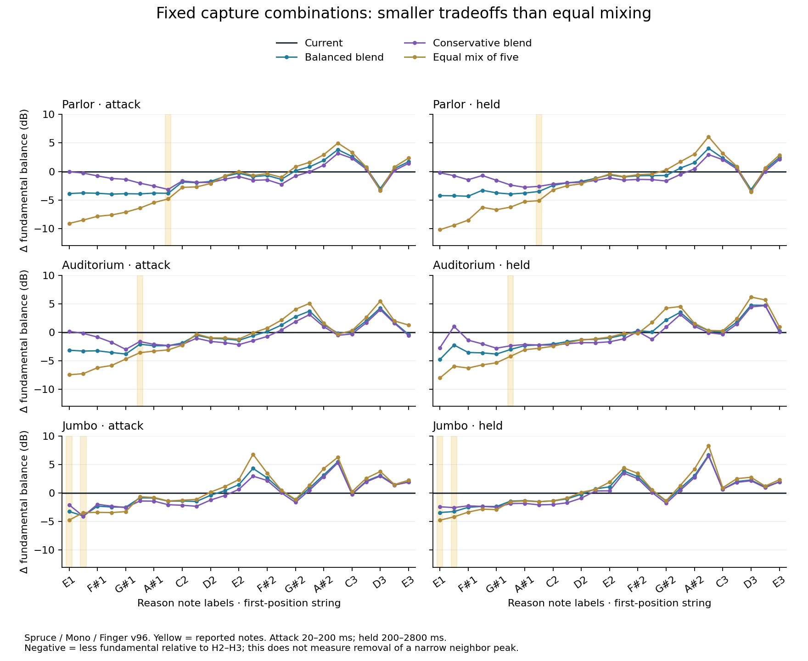

# Fixed combinations of the microphone experiments

Follow-up: the user subsequently approved the balanced combination. See the
[implemented blend and native A/B](studio-capture-implementation-2026-10-11.md). The evidence below records the earlier research stage.

A weighted combination is more promising than an equal mixture of the five
previous experiments. The balanced blend consistently reduces the reported
notes' fundamental prominence in the tested playing conditions, with smaller
low-note losses than the equal mix. It remains a **listening candidate**:
the narrow note-to-neighbor peak is mostly retained, and some higher harmonics
and continuous transfer responses acquire deeper cancellation.

These are microphone observation experiments on current ACUSTRA
`d54efb2800a12130cd1027a8d64c1c0970e0ae9b`, containing the latest fetched main
`a534d774aa85f31acac6e74e6efebc18221ec748`. Body physics, piezo, source poles,
the existing capture filters and construction levels remain unchanged. No new
EQ was added, and no production/Rack version was changed.

## The combinations

One fixed set of weights applies to every model, wood, note, input, channel
and frequency. Complex observation coefficients are summed before rendering,
so the mixture retains phase interference. There are no note-specific gains,
added delays, phase rotations or new filters.

| Constituent | Balanced blend | Conservative blend | Equal-five control |
|---|---:|---:|---:|
| Current capture | 40% | 70% | 0% |
| Unboosted measured bridge response | 20% | 20% | 20% |
| Constrained neck projection, 30 cm | 10% | 0% | 20% |
| Constrained off-hole projection, 45 cm | 10% | 0% | 20% |
| Measured-phase neck projection, 30 cm | 10% | 0% | 20% |
| Measured microphone mix | 10% | 10% | 20% |

The spatial constituents first receive their declared nominal distance
compensation: ×3 for the 30 cm variants and ×4.5 for 45 cm. This removes the
common distance level difference before weighting. It does not establish
spatial accuracy. The conservative blend retains the current capture's
authored low-mode sensitivity; its name does not imply purely raw measurements.

These are mixed observations, not a newly measured single studio microphone
position. The earlier spatial projections' limitations still apply inside a
blend. See the [individual-variant report](studio-capture-variants-2026-10-11.md).

## Results on the original comparison grid

Three mixtures were rendered natively through the frozen DSP, 600 cases each.
The grid covers four shapes, Spruce/Mahogany, Stereo mic, Mono mic and Piezo,
with extra microphone notes through Reason E3. No post-render gain is used
in numerical measurements.

The table gives median change in fundamental power relative to the mean power
of harmonics two and three at the reported notes. Negative values mean less
fundamental prominence, not a change in physical modal damping.

| Blend | Parlor B1 attack / held | Auditorium A1 attack / held | Jumbo E1–F1 attack / held |
|---|---:|---:|---:|
| Balanced | −2.36 / −3.02 dB | −2.37 / −2.72 dB | −2.93 / −3.16 dB |
| Conservative | −1.91 / −2.24 dB | −1.89 / −2.24 dB | −2.05 / −2.09 dB |
| Equal five | −3.39 / −4.46 dB | −3.73 / −3.66 dB | −4.04 / −4.41 dB |

Attack is 20–200 ms; held is 200–2800 ms. Both microphone routes, both woods
and available target string routes contribute to each median.

The balanced blend lowers the target attack fundamentals themselves by about
2.0–2.3 dB. The maximum fundamental loss elsewhere across attack/early/held
is 4.73 dB, versus 10.05 dB for the equal mix. Maximum upper-note fundamental
gain is 1.93 dB versus 4.40 dB. The conservative blend has smaller extrema,
but also a weaker target improvement.

However, target attack note-to-neighbor contrast changes by only about
0.03–0.11 dB. This is a reduction in spectral prominence, **not removal of
the narrow resonant note peak**. Higher partials can also weaken: the original
grid includes second/third-harmonic losses around 8–9 dB in some upper notes.

## Check with different excitation

Weights were frozen before a separate 768-clip test: baseline and the two
selected blends, 256 clips each, using Pick velocity 120 and Thumb velocity
56. All four shapes, both exposed woods, both microphone routes and eight
notes were included. Some string routes also differ from selection.

Both blends reduce target fundamental prominence in all 128 target/window
observations per blend. Across attack and early windows, the balanced blend
gives **1.62–4.27 dB reduction**; the conservative blend gives 1.18–4.21 dB.
The balanced blend's target attack medians are −2.71 dB Parlor, −2.51 dB
Auditorium and −2.93 dB Jumbo. No clipping or nonfinite output occurred.

The test also confirms tradeoffs. Jumbo/Spruce Mono, Thumb B2, acquires about
7.8 dB more fundamental prominence primarily because its second harmonic
falls about 7.2 dB; the fundamental rises only 0.93 dB. The balanced blend's
worst held low-note fundamental loss is 4.81 dB, on a quiet open-E component
whose baseline level is −75.36 dBFS. These figures describe different effects
and should not be collapsed into a single quality score.

See the [holdout report](../validation/capture-combinations-2026-10-11/holdout-report.md)
for absolute levels, time windows, stereo fold-down and full limits. This
tests additional playing conditions on the same model; it is not independent
studio measurement validation.

## Remaining cancellation

The continuous force/moment sweep finds narrow, physically relevant transfer
holes. For the balanced blend and normalized moment/force −1, Parlor's stereo
sum loses an additional 15.27 dB near 254.106 Hz (Spruce) and 17.54 dB near
244.691 Hz (Mahogany). Intervals with more than 6 dB loss are about 0.8 Hz wide.
Auditorium/Maple has a still deeper point loss near 220.657 Hz; Maple was not
included in the native playing holdout.

These deepen or shift existing response zeros. The normalized −1 drive is a
meaningful bass-side force/moment ratio, not an arbitrarily excessive torque.
An actual note has a frequency-dependent complex ratio and multiple partials,
so a point transfer loss is not whole-note attenuation. Conversely, a narrow
hole can still affect a sustained harmonic or be crossed by tuning/bending.
Integrated harmonic-band measurements cannot dismiss it.

The conservative blend also has deep narrow holes; it is not a proven remedy
for that issue. The [refined notch measurements](../validation/capture-combinations-2026-10-11/notch-widths.json)
retain exact intervals, source hashes and baseline/candidate local shape.

## Listening

The short comparisons play **current capture first, then the balanced blend**.
They use Spruce / Mono. A single scalar gain per blend is shared across all
12 phrases (three shapes × two woods × two captures), with no per-note
normalization. The balanced blend receives +1.223 dB for these auditions only;
native analysis and coefficient files retain their original levels.

- [Parlor: E1, F#1, B1, B2](../build-audit/studio-mic-combinations-20261011/presentation/parlor-spruce-mono_mic-current-vs-balanced.wav)
- [Auditorium: E1, A1, A#1, G#2](../build-audit/studio-mic-combinations-20261011/presentation/auditorium-spruce-mono_mic-current-vs-balanced.wav)
- [Jumbo: E1, F1, D#2, F2](../build-audit/studio-mic-combinations-20261011/presentation/jumbo-spruce-mono_mic-current-vs-balanced.wav)

Full four-way comparisons: [Parlor](../build-audit/studio-mic-combinations-20261011/presentation/parlor-spruce-mono_mic-all-combinations.wav),
[Auditorium](../build-audit/studio-mic-combinations-20261011/presentation/auditorium-spruce-mono_mic-all-combinations.wav),
[Jumbo](../build-audit/studio-mic-combinations-20261011/presentation/jumbo-spruce-mono_mic-all-combinations.wav).
Order: current at 0 s, balanced at 5.72 s, conservative at 11.44 s, equal five
at 17.16 s. Both woods and both microphone routes are available in the
[audition manifest](../validation/capture-combinations-2026-10-11/audition-manifest.json).
No human listening preference or acceptance is assumed.

## Reproduction and isolation

Selection used a 3,003-point constant-weight simplex grid plus named proposals
and controls: 3,035 evaluation rows representing 3,023 distinct weight vectors.
Cross-spectral power matrices preserve phase cross terms; decibel spectra were
not averaged. Preliminary bounds limited target worsening, fundamental loss,
neighbor contrast changes, upper-note gain and stereo cancellation. These
are screening choices, not physical acceptance laws. The equal-five control
violates the chosen fundamental-loss and upper-note-gain bounds. There was
no further tuning after the separate excitation check.

Independent controls reproduce previous pure-variant metrics within
5×10⁻¹⁴ dB. Native mixture output agrees with the predicted waveform mixture
to under 2.7×10⁻⁷ absolute sample error. Every one of the 136 Piezo clips per
selected blend is byte-identical to baseline. Prepared construction memory
outside microphone coefficient fields, cached poles, mechanical/piezo traces
and the full bridge/body modal-state witness are unchanged.

Evidence: [native summary](../validation/capture-combinations-2026-10-11/native-summary.json),
[screen summary](../validation/capture-combinations-2026-10-11/screen-summary.json),
[independent metric review](../validation/capture-combinations-2026-10-11/independent-metric-review.json),
[native prediction check](../validation/capture-combinations-2026-10-11/native-prediction.json),
[balanced isolation](../validation/capture-combinations-2026-10-11/balanced-all/observation.invariants.json),
[conservative isolation](../validation/capture-combinations-2026-10-11/measured-continuity/observation.invariants.json).

The archived [balanced coefficients](../validation/capture-combinations-2026-10-11/balanced-all/observation.csv)
and [manifest](../validation/capture-combinations-2026-10-11/balanced-all/manifest.json)
are a concrete research candidate for the frozen 48 kHz harness, not a portable
production parameter table. Full audio and frozen reproduction inputs remain
in local `build-audit/studio-mic-combinations-20261011`. No Rack rebuild or
installation accompanies this experiment.
