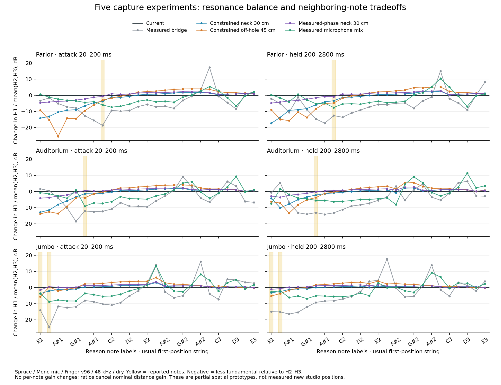

# Studio microphone capture experiments — 2026-10-11

Follow-up: the user subsequently approved the balanced combination. See the
[implemented blend and native A/B](studio-capture-implementation-2026-10-11.md). The evidence below records the earlier research stage.

Follow-up: [fixed combinations of these captures](capture-combinations-2026-10-11.md)
give a better played-note compromise, including a separate excitation check.
Higher-partial and narrow transfer cancellations remain; no production replacement
has been accepted.

Five microphone-only variants were implemented in an isolated renderer and
compared with the current ACUSTRA model. Some reduce the reported low-frequency
emphasis but introduce weak neighboring notes or stronger upper bass. The
variant that most closely fits the measured microphone responses preserves
low notes better, but does not consistently reduce the reported emphasis.
**None is accepted as a production replacement.** No new EQ, production DSP,
body physics, piezo, construction trim or Rack Extension pin was changed.

The reference is `d54efb2800a12130cd1027a8d64c1c0970e0ae9b`, containing the
latest fetched `origin/main` (`a534d774aa85f31acac6e74e6efebc18221ec748`).
All comparisons use this current model, rather than historical model versions.
The reported Reason notes are Parlor B1 (123.47 Hz), Auditorium A1 (110 Hz),
and Jumbo E1–F1 (82.41–87.31 Hz).

## What was tried

The spatial experiments change complex microphone observation coefficients.
They retain the existing mechanical poles, excitation, feedback and piezo.
No additional filter follows the microphone sum. The existing capture filter
cascade remains identical in every comparison.

| Experiment | Capture hypothesis | Principal finding |
|---|---|---|
| Measured bridge | Use the actual, unboosted treble bridge pressure response for both channels and Mono | Large reduction in target fundamental balance, but a new Parlor F#1 dip and substantial changes elsewhere |
| Measured microphone mix | Constant averages of the existing treble/bass and upper pressure responses | Moderate target reduction, but additional Jumbo upper-bass cancellation |
| Constrained neck, 30 cm | Finite soundboard/hole radiation at the neck joint, using the existing coupled-mode source relationship | Target held balance falls about 1.7–3.6 dB; Parlor open E1 fundamental can fall about 16 dB after compensating distance |
| Constrained off-hole, 45 cm | Same radiation model with a more distant body-front observation | Target held balance falls about 2.3–5.3 dB, with severe low-note cancellation and greater upper-bass emphasis |
| Measured-phase neck, 30 cm | Fit independent complex soundboard/hole strengths to all three measured microphones | Smallest low-note disruption, but inconsistent reduction of the reported attack and held emphasis |

The first two are controls using actual 10 cm measurements, not new studio
positions. The three spatial variants predict only the identified low air/top
mode observations; other modes retain their current phase and receive a common
nominal distance gain. These are partial spatial experiments, not a complete
broadband microphone-position or cardioid-capsule model.

## Resonance results

Each candidate was compared with 600 baseline cases: four body shapes, Spruce
and Mahogany, Stereo mic, Mono mic and Piezo, plus an extended microphone grid
through E3. That is **3,000 candidate clips**, with attack, early, held and late
measurements assessed independently. Renders use Finger velocity 96, 48 kHz,
Room 0, Body 0.82, Output 0.42 and Width 0.62. Four-second notes are released
at three seconds. This is a defined comparison grid, not exhaustive performance
or sample-rate validation.

The main spectral metric is fundamental power relative to the mean power of
harmonics two and three. A negative change means less fundamental emphasis;
it does not necessarily mean a quieter fundamental. Absolute fundamental
level, RMS, neighboring-note balance, stereo summation and complex transfer
functions were checked separately.

Parlor B1 is about **5.6–5.8 dB above its same-string neighbors during the
attack**, but its held fundamental is weaker. Judging the sustained sound
alone would miss the initial problem. The measured-phase neck experiment
improves this attack neighbor contrast by less than 0.12 dB.

For that closest-fitting spatial experiment, target fundamental-balance changes
are:

| Shape / reported note | Attack, 20–200 ms | Held, 200–2800 ms |
|---|---:|---:|
| Parlor B1 | −0.65 to +2.84 dB | −0.90 to +0.41 dB |
| Auditorium A1 | −0.33 to +1.13 dB | −0.52 to +0.23 dB |
| Jumbo E1–F1 | −1.73 to +0.99 dB | −1.41 to −0.45 dB |

Ranges include both rendered woods, both microphone captures and available
string routes. The reduction is not consistent enough to call this a fix.
Its largest low-note fundamental loss is about 2.7 dB after distance matching,
while upper-note fundamental gains reach about 3.8 dB. A separate transfer
sweep also finds a deep Parlor/Maple notch near 257 Hz for one extreme
force/moment combination; Maple was not part of the played-note grid.

The microphone mix weakens Jumbo/Mahogany D#2 fundamental by about 9.7 dB,
worsening its neighbor contrast by about 11 dB. Elsewhere a large harmonic
ratio increase mostly reflects cancelled higher harmonics, rather than an
equally large increase in bass. This is why a single target-band score is
insufficient for acceptance.

See the [complete comparison](../validation/studio-capture-2026-10-11/comparison-summary.md)
and [machine-readable results](../validation/studio-capture-2026-10-11/comparison-summary.json)
for all five variants, windows, adverse cases and transfer-function checks.

## Measurement basis and remaining uncertainty

Professional placement guidance supports starting around 25–30 cm from the
neck/body joint and moving away from excessive soundhole contribution.
That is a recording starting point, not a measured transfer function for
ACUSTRA's source guitar.
[LEWITT application guide](https://www.lewitt-audio.com/blog/how-to-record-acoustic-guitar-at-home-0).

The existing [Robert Mores archive](https://zenodo.org/records/4604577),
licensed CC BY 4.0, provides three complex pressure observations 10 cm above
the instrument. Its Method.pdf explicitly says those points are too sparse
for near-field reconstruction; its measured 1 m response is omitted from the
public dataset. Published geometry also contains an uncertain lower-bout
width, so both the literal value and an alternative geometric prior were
examined. Missing mode shapes, back radiation and edge diffraction remain
unvalidated assumptions.

The constrained radiation model predicts the held-out low-air-mode microphone
response poorly: roughly 60–92% complex error at the literal geometry. The
free two-source fit using all three microphones has much smaller training
errors (about 2–6.5% for heave, 15–23% for moment) and a condition number
around 5.2–5.8. Fitting those three points does not validate pressure at a
new 30 cm position. The symmetric bridge pair alone cannot reliably predict
the third microphone.

Additional raw [Princeton NBody measurements](https://citeseerx.ist.psu.edu/document?doi=7f13cfb04e64d6f43c12971c9c2ed6e740c2d486&repid=rep1&type=pdf)
show spatial low-air/plate balance changes of several dB: one tested direction
lowers the ratio about 2–7 dB, while another raises it about 3–6 dB. The data
support spatial variation, but not a universal bass reduction or a specific
neck-direction transfer for ACUSTRA. No NBody coefficients are used here.

The [Surrey microphone IR dataset](https://zenodo.org/records/4633508) supplies
useful capsule/distance/angle evidence but cannot identify this guitar's
soundboard/hole field. [GuitarSet](https://zenodo.org/records/3371780) has a
studio microphone recording at one position, without the matched pressure
observations needed to separate placement from instrument excitation. Other
array datasets were unsuitable for shipping coefficients because of licensing,
missing complex phase, or absence of a matched near-field measurement.

A credible production replacement needs additional matched complex-pressure
measurements at studio positions, or a radiation model validated against such
measurements. These experiments do not establish that microphone placement
cannot solve the problem; they establish that the tested approximations do
not yet solve it reliably.

## Listening comparisons

The short comparisons play **current capture first, then the measured-phase
30 cm experiment**. Both are Spruce / Mono mic. A single gain per variant was
calculated across all 12 comparison phrases; notes were not individually
normalized. These are listening materials, not evidence of listening approval.

- [Parlor: E1, F#1, B1, B2](../build-audit/studio-mic-variants/presentation/parlor-current-vs-measured-phase-neck.wav)
- [Auditorium: E1, A1, A#1, G#2](../build-audit/studio-mic-variants/presentation/auditorium-current-vs-measured-phase-neck.wav)
- [Jumbo: E1, F1, D#2, F2](../build-audit/studio-mic-variants/presentation/jumbo-current-vs-measured-phase-neck.wav)

Full six-way comparisons are available for both woods and both microphone
captures in the [audition manifest](../validation/studio-capture-2026-10-11/audition-manifest.json).
Direct Spruce / Mono comparisons: [Parlor](../build-audit/studio-mic-variants/presentation/parlor-spruce-mono_mic-comparison.wav),
[Auditorium](../build-audit/studio-mic-variants/presentation/auditorium-spruce-mono_mic-comparison.wav),
and [Jumbo](../build-audit/studio-mic-variants/presentation/jumbo-spruce-mono_mic-comparison.wav).
Each file uses this order: current at 0 s, measured bridge at 5.72 s,
constrained neck at 11.44 s, constrained off-hole at 17.16 s, measured-phase
neck at 22.88 s, measured mix at 28.60 s. WAVs remain in the local ignored
`build-audit/studio-mic-variants/presentation` directory.

## Isolation and reproducibility

All 136 Piezo clips per candidate are byte-identical to the reference. Separate
runtime checks compare 96,000 mechanical/piezo trace samples per candidate,
plus a 512-sample full bridge/body modal-state witness. Prepared construction memory outside the
eight microphone coefficient fields and all cached pole bits are unchanged
across all 12 constructions. All rendered output is finite, with no added
full-scale clipping.

The [isolation receipts](../validation/studio-capture-2026-10-11/observation-isolation.json),
[scorer controls](../validation/studio-capture-2026-10-11/scorer-controls.json),
[final scoring checks](../validation/studio-capture-2026-10-11/final-scoring-checks.json)
and [commands](../validation/studio-capture-2026-10-11/commands.md) preserve the
verification. The local scratch harness links the frozen current DSP library
and injects only observation coefficients. Reproduction commands require those
frozen local inputs; the archived Python scripts are evidence, not a new
standalone product build. No new Rack build or Recon installation was made
because no candidate was accepted.
