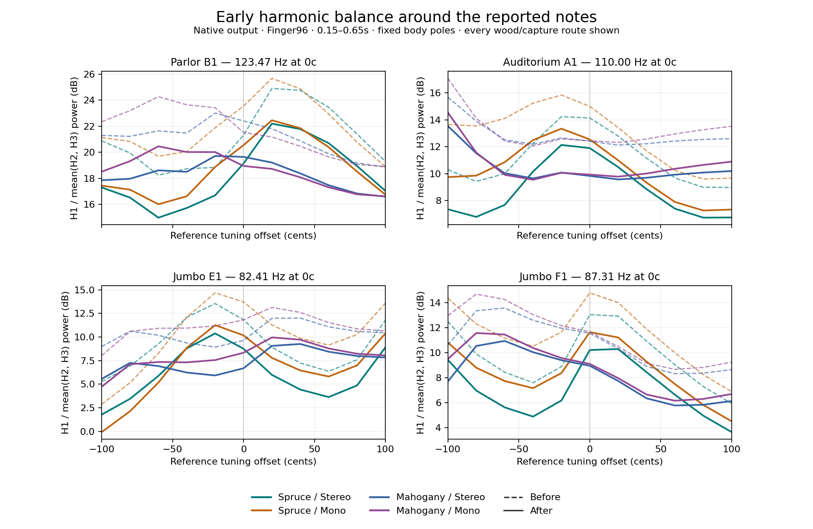

# Balanced studio capture implementation — 2026-10-11

The user approved implementing the balanced microphone blend after the
[combination auditions](capture-combinations-2026-10-11.md). The canonical
engine now computes it directly; the comparison renderer no longer injects
prepared observation coefficients. There is no added equalizer, note-specific
cut, new physical damping or change to the piezo path.

## Observation model

The mixture is 40% preceding capture, 20% unboosted measured treble response,
10% constrained neck at 30 cm, 10% constrained off-hole at 45 cm, 10%
measured-phase neck at 30 cm, and 10% measured microphone averages. The spatial
terms receive their declared common distance compensation first (3, 4.5, 3).
Weights are fixed across notes, constructions, inputs and channels.

Raw complex force/moment microphone residues are blended before the existing
construction gain and sample-rate conversion. Four A0/T1 modes additionally
use continuous-pole plate/hole projections from generated, rate-independent
Green-kernel series; other measured modes use fixed measured-tap mixtures.
The high-band continuation is first generated from its previous observation
and then mixed, preserving the accepted prototype. The existing coefficient
cache prepares this work before playback. No per-sample observer work is added.

`Tools/GenerateStudioCapture.py --check` reproduces the header from existing
CC BY 4.0 Mores-derived pressure data and explicit geometry assumptions.
The finite-radiator geometry remains a projection prior. This is not a newly
measured studio placement or a complete directional-capsule model. Existing
capture filters, legacy construction trims and output routing remain unchanged.
A separate flat microphone level correction restores the preceding phrase
loudness, independently for Stereo and Mono. Piezo uses its exact original
reference product; it receives none of this correction.
Existing songs intentionally hear the new microphone balance.

## Raw-blend A/B around the reported notes

The latest preceding model (`d54efb2`) was frozen as the comparison. Both
versions render 296 matched cases: 176 Finger96 cases at 20-cent steps over
±100 cents around four note centres, 96 Pick120/Thumb56 cases at −50/0/+50
cents, and 24 focused Parlor low-E cases around nominal third harmonics of
245/254 Hz. Both visible woods and both microphone captures are covered.
One frozen preceding baseline is used for A/B; no historical model matrix
or older DSP rebuild is performed.

Master Tune shifts string tension and sympathetic references while preserving
open/stopped geometry and fixed body/microphone poles. It is a physically
consistent played-note sweep, not a pure externally applied sinusoidal force.
The zero-cent scratch renderer reproduces the original baseline byte for byte.

At the exact reported notes, in the early 150–650 ms window:

| Reason note | Frequency | Reduction of H1 relative to H2/H3 |
|---|---:|---:|
| Parlor B1 | 123.47 Hz | 2.18–3.00 dB |
| Auditorium A1 | 110.00 Hz | 2.24–2.57 dB |
| Jumbo E1 | 82.41 Hz | 2.95–3.54 dB |
| Jumbo F1 | 87.31 Hz | 2.56–3.14 dB |

Ranges include both woods and routes. All 704 primary and 384 bounded
Pick/Thumb target/window observations reduce fundamental prominence. The
primary range is 1.23–5.68 dB and the bounded range is 1.11–4.84 dB. Numerical
measurements use raw output levels. Auditions apply one shared matching gain
per capture across the complete primary grid: +1.711 dB Stereo, +1.756 dB Mono.
No per-note normalization is used.

This improves harmonic balance; it does **not remove the local pitch peak**.
Auditorium A1 remains about 1.9 dB above the two ±100-cent endpoint powers;
Jumbo F1 remains about 1.5–1.7 dB above them. Modal Q is unchanged. The focused
245/254 Hz cases lose at most 3.30 dB in H3 (Parlor/Mahogany Mono Finger attack,
−63.19 to −66.48 dBFS). Narrow transfer zeros documented in the earlier report
remain possible; short-window harmonic integration cannot rule them out.
Peaks were −12.36 dBFS before and −13.64 dBFS after, with no clipping or
nonfinite output. No new listener preference is inferred from these metrics.

The [complete A/B report](validation-studio-capture-implementation-20261011/ab/comparison/REPORT.md)
retains individual curves, windows, partial extrema, source/binary hashes and
audition segment manifests. Audio remains in the local ignored
`build-audit/capture-implementation-20261011/ab/comparison/audition/` directory.

## Isolation and numerical verification

All 1,920 production observations (7,680 complex residues) match the approved
48 kHz prototype with maximum relative error 4.77e−7; exact zero entries remain
zero. All pole and capture-filter coefficients remain bit-identical. Independent
original-quadrature checks cover 6,800 Green kernels with maximum relative
error 3.46e−15 and Taylor remainder bound 3.35e−18 over 45–400 Hz and Q .05–150.

The focused permanent contract checks 576 complex approved observations,
seven rates spanning 8–384 kHz, and 16 calibration corners across all twelve
stored constructions (including legacy Maple). Actual corner poles remain
80.61–216.93 Hz and Q .715–57.55, within the verified kernel domain.

A separate production trace, with no coefficient injection, compares all
12 constructions at 44.1/48/96 kHz. All 564,812 inspected frames preserve
mechanical/Piezo/modal-state traces and Piezo bus audio byte for byte. Microphone
audio changes in every case. This covers the short sounding/release/repluck/chord
fixture and a 512-frame full modal-state witness; waveguide delay buffers are not
dumped, and very late inaudible idle-reset timing is not asserted. See the [isolation receipt](validation-capture-combinations-20261011/production-isolation/normalized-phase2/summary.json).

## Flat microphone level correction

The first full regression run found a real level mismatch: eight Parlor
settings fell outside the existing ±3 LU independent-phrase guard (worst
−3.98 LU relative to the default construction). That bound was not relaxed.
The microphone mixture reduced energy differently across constructions.

A second stage adds only a flat output gain for each construction, Picking
and microphone route. Gains are derived from the preceding and raw-blend
BS.1770 loudness on the existing fixed calibration phrase set. They restore
prior phrase levels without changing the mixture's spectral or phase balance.
The legacy level tables and exact piezo reference multiplication remain intact.
The existing reference followers smooth changes; no new control is introduced.

The initial Engine/Release/Wood test failures also exposed microphone-dependent
measurements inside physics contracts. Finger velocity now pins its original
reference observation, slide-release damping measures travelling-wave slope norm, and the low-mode Wood test checks the antisymmetric measured response
(the spatial contributions cancel in L−R). Original physical thresholds remain
unchanged; separate production capture tests still exercise the new observer.
Negative controls reject the old microphone in the approved-observer fixture
and reject damping at the wrong unslid pitch.

## Final normalized A/B

The final runtime is canonical commit `edba92084e36bac4ab6962fdcec1a36f9a0b3b6e`.
Its native DSP library SHA-256 is
`282ae53ffe4a0f977bb9c11ec4c06858303dd118aa00a03bc8315e021da7ca00`.
A fresh 296-case final render is compared against the same frozen baseline;
raw-blend evidence above is retained separately.

All harmonic-balance reductions reported above remain, while exact-centre
early-window H1 changes are now −0.72 to −1.08 dB for Parlor, −1.26 to
−2.00 dB for Auditorium, −1.58 to −2.31 dB for Jumbo E1, and −1.39 to
−1.98 dB for Jumbo F1. Local pitch-peak contrasts also retain their previous
limitations. The focused Parlor H3 worst loss is 1.94 dB (−63.19 to
−65.13 dBFS). Peak across this targeted set is −12.15 dBFS, versus
−12.36 dBFS before. All clips are finite and unclipped.

Final auditions use one shared scalar per route over the whole primary sweep:
+1.371 dB Stereo and +0.912 dB Mono after; no note-specific matching. Short
centre comparisons play before at 0–4 s and after at 4.35–8.35 s. See the
[final A/B report](validation-studio-capture-implementation-20261011/ab/comparison-final/REPORT.md),
[exact measurements](validation-studio-capture-implementation-20261011/ab/comparison-final/comparison.json)
and [audition manifest](validation-studio-capture-implementation-20261011/ab/comparison-final/audition/centres/manifest.json).

The level generator measured 72 paired construction/style/microphone cells.
Its gains span −0.145 to +2.777 dB. A separate 144-render final verification
checks the full calibration phrase and hardest score in every cell. Prior
phrase loudness is restored within 0.01578 LU; the largest native hard-case
peak is −2.10003 dBFS, with no limiter activation. The original extra
0.001-LU diagnostic flags are retained: five Mono cells cross a BS.1770 gate
boundary after scaling. A native-versus-ideal-scalar witness agrees to
−148.86 dB relative RMS and identifies the gate change; no gain was refitted
to conceal it. See the [level-match report](validation-studio-capture-implementation-20261011/level-match/REPORT.md).

The final [physics receipt](validation-studio-capture-implementation-20261011/physics-final/provenance.json)
and [production isolation](validation-capture-combinations-20261011/production-isolation/normalized-phase2/summary.json)
use the normalized final library. All observation coefficients remain
byte-identical to the raw-blend implementation, and mechanics/Piezo remain
byte-identical to the original baseline within the trace scope stated above.

## Final native build and regression

The final arm64 Release build completed for DSP, tools, Standalone, AU and
VST3. The [native validation receipt](validation-studio-capture-implementation-20261011/native-validation/receipt.json)
retains compact unmodified build/test logs, relevant CMake settings, architecture
inspection and the final test-source hashes. This native build is not a new
universal JUCE plugin validation.

The full registered run passed 88 of 89 tests. Its remaining `Acustra.Engine`
failure came from the construction/picking transition test oracle omitting the
new `studioStereoLevelMatch` factor. The test-only repair uses the complete
microphone reference while retaining waveform equality, monotonic gain,
1e−5 tolerances and the 40 ms fade bound. The rebuilt complete Engine test then
passed. This test-only repair is commit `5402854`; no production DSP or library
changed. Together the original 88 passes
and the focused Engine rerun cover **89/89 distinct tests**. The original
failed log is retained, and no all-green single full-run result is claimed.
See the [repair review](validation-studio-capture-implementation-20261011/physics-final/engine-transition-review.json)
and [test-only patch](validation-studio-capture-implementation-20261011/native-validation/engine-transition-oracle.patch).

The independent construction-loudness guard passes at its original ±3 LU
threshold. The separate level-meter diagnostic and its five gate-boundary flags
remain as described above; they are not silently converted into passes.

## Rack integration and bounded performance

The sibling `reason-rack-extension` repository records Rack 1.2.7f1 in
`Examples/Acustra/Docs/VALIDATION-1.2.7f1.md`. The validated build source `7046c5a` pins
canonical DSP `edba920`; all seven local contracts and the universal SDK build
passed. The archive is 29,148,793 bytes, SHA-256
`bd0a1fc97de127198570dc12d0a7434a5463db3bc42d4638aaeef8aed5b78a6f`.
Protected ReconCLI fresh creation/conversion also passed. This does not assert
interactive Reason playback or a new listening preference.

Eight paired tests of the actual preceding/current SDK modules cover strums,
a Pick run, bends and construction changes at 48/192 kHz, with eight-second
traces plus warmup. Piezo samples and output-written flags are byte-identical
in those traces; the Rack receipt `Docs/validation-1.2.7f1/sdk-piezo.json`
records the evidence. This remains a bounded trace claim, not an assertion
about all late idle transitions.

The Rack callback comparison uses 18 fresh-process runs per version. Current
thread CPU has zero deadline misses and a maximum of 823.375 µs against a
1,333.33 µs deadline; the baseline has one CPU miss, maximum 1,606.25 µs.
Reported case medians change by −1.5% to +0.6%. Wall time still overruns in
both versions (baseline maximum 3,336.833 µs; current 2,668.625 µs), so the
strict all-wall-time criterion remains **false**. These host-specific results
do not establish universal realtime safety. The complete per-run timing and
aggregation belong to the separate Rack release receipt.

