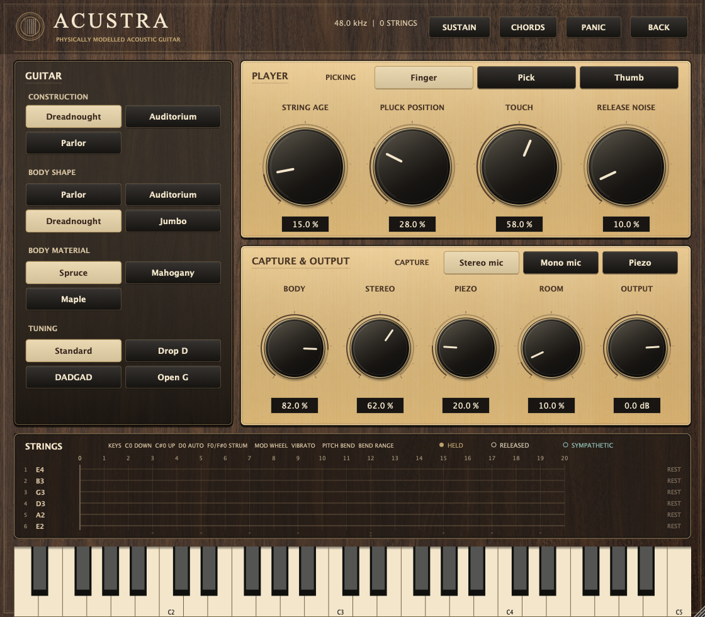

# Acustra

Acustra is an acoustic-guitar instrument for VST®3, CLAP, Audio Unit and
Standalone hosts. It synthesises every note in real time from six physical
string models, a passive measured bridge and a measurement-derived guitar
body. The plug-in contains no sample player and no recorded note audio. The
[user guide](Docs/guide/user-guide.md) covers installing and playing it.

[](Docs/screenshots/acustra.png)

## Audio demos

One demo per factory preset, each played from its own phrase in
[`Docs/audio/midi/`](Docs/audio/midi) through the same `Performer` the plug-in
plays, at 48 kHz with no processing after the engine. Every main build renders
them with [`Tools/RenderPresetDemos.cpp`](Tools/RenderPresetDemos.cpp) and
rewrites this table. Longer technique and repertoire renders are described in
[Technique and repertoire renders](#technique-and-repertoire-renders).

<!-- audio-demos-begin -->

| # | Preset | Demo | Length | Peak |
| --- | --- | --- | --- | --- |
| 1 | Dreadnought Steel | [01-dreadnought-steel.wav](Docs/audio/01-dreadnought-steel.wav) | 11.7 s | -2.9 dBFS |
| 2 | Parlor Steel Fingerstyle | [02-parlor-steel-fingerstyle.wav](Docs/audio/02-parlor-steel-fingerstyle.wav) | 11.6 s | -2.9 dBFS |
| 3 | Mahogany Steel Thumb | [03-mahogany-steel-thumb.wav](Docs/audio/03-mahogany-steel-thumb.wav) | 11.8 s | -5.1 dBFS |
| 4 | Jumbo Steel Pick | [04-jumbo-steel-pick.wav](Docs/audio/04-jumbo-steel-pick.wav) | 11.1 s | -2.7 dBFS |
| 5 | Palm Muted Steel Pick | [05-palm-muted-steel-pick.wav](Docs/audio/05-palm-muted-steel-pick.wav) | 11.2 s | -1.5 dBFS |
| 6 | DADGAD Mono Mic | [06-dadgad-mono-mic.wav](Docs/audio/06-dadgad-mono-mic.wav) | 11.2 s | -2.7 dBFS |
| 7 | Open G Slide-ready | [07-open-g-slide-ready.wav](Docs/audio/07-open-g-slide-ready.wav) | 11.5 s | -2.3 dBFS |
| 8 | Piezo Stage Steel | [08-piezo-stage-steel.wav](Docs/audio/08-piezo-stage-steel.wav) | 10.6 s | -1.5 dBFS |

<!-- audio-demos-end -->

## Version history

Each entry is a source version in this repository; none has been published
as a release yet. Earlier dated entries (2026-08-31 to 2026-10-10) and the
long per-version notes are in the
[release history](Docs/release/release-history.md).

### 1.9.45 — 2026-11-12 — a plucked string starts at rest at the bridge

- Finger and Thumb lose a brightness that did not belong to the hand, most
  on the wound strings. The released string was written with a kink where
  it meets the bridge, a notch in every period as bright as a pick's
  corner, so a soft pluck's upper partials stood within 3 dB of a hard
  one's and from E2 to D4 a plucked note's ninth to twentieth partials
  stood 13-20 dB over the recorded Eastman E1D's and over a second plucked
  guitar's (the Crafter sample library). The period now starts where the
  rounded corner turns: a low E plucked at velocity 30 carries those
  partials 10-20 dB lower, and soft and hard strokes differ in brightness
  as well as level. The Thumb's partials above the eighth fall 2-6 dB.
- The fingertip's 0.7 mm stays. Against the recorded finger-to-pick
  contrast the second to twelfth partials now stand a mean 5.4 dB over
  from E2 to B2 and 2.5 over from E3 to D#4 (10.8 and 8.5 before), 4.0
  under from E4 to D#5 and level from E5 to C6.
- Finger and Thumb play at the loudness they had: their level cells were
  re-measured.

### 1.9.44 — 2026-11-12 — the fingertip lets go as the recorded player's does

- Finger is darker, on every string. The recorded player's plucked notes
  lose their upper partials against the same player's picked notes on the
  same guitar (4 dB at the second partial, 12 at the fifth, 19 at the
  eighth on the low strings; 13 dB from the fifth up on the first string's
  upper frets), and the model's Finger stood within 3 dB of its own Pick.
  The fingertip now lets the string go over 0.7 mm, where 0.2 mm was
  authored: from E4 to C6 its partials lie a mean 0.6 dB under that
  recorded contrast, where they stood 7.3 dB over it. Soft strokes darken
  more than they did. A firmer Touch brings brightness back.
- Finger plays at the loudness it had: its level cells were re-measured, and
  Parlor Steel Fingerstyle, DADGAD Mono Mic and Open G Slide-ready load with
  Output 0.6 to 0.9 dB higher to hold their level on the meter. A session
  keeps the Output it saved, so a Finger session plays up to 1 dB quieter.
- A lone note keeps to the strings beside the last one plucked when a fret
  under the hand can sound it: up the neck, E4 after C4 on the D string's
  tenth fret is the G string's ninth, where it was the open first string.
  In first position the open string is still taken.

### 1.9.43 — 2026-11-12 — a fretting hand with a position

- The fretting hand now has a position on the neck, beside each string's
  last finger, and a note or chord costs a fret for each fret the hand would
  move from it. An open string no longer lifts the hand off the neck: after
  E4 on the open first string, F4 is its first fret, where it was the B
  string's sixth. A line no longer drags the hand along one string: a
  chromatic octave from F3 is played four frets to a string in first
  position. Coming down a scale the hand stays where it climbed to and takes
  the open strings it passes (C major down from C5: first string 8, 7, 5, 3,
  B string 6, open E, G string 7, 5, open B, D string 7, open G), where it
  walked back to first position. Keyboard lines and chords that follow a
  position change are fretted differently, so they sound from other strings.
- Frets past the twelfth are taken only by a hand already there. After
  climbing the first string to C6, E5 and D5 come back down it to the
  twelfth and tenth frets.
- When the hand shifts position with fingers on the strings, the finger that
  lands on a wound string it did not hold slides in along the winding by the
  frets the hand moved, at half the force of a finger that held the string.
  The level is authored. Release Noise scales it, and 0% silences it.
- Impossible combinations are still never dropped: a shape no one hand
  reaches is played, ranked after every shape one reaches.

### 1.9.42 — 2026-11-11 — the upper frets against the flat-top recordings

- The Pick's hand now sits 141 mm from the saddle at the default Pluck
  Position, where the picked Eastman E1D take's own pluck-point comb puts
  it, 0.95 of the Finger's distance. It sat at 60 mm, a figure fitted on a
  picked archtop. On the notes from F#4 to C6 the model's partials between
  1.1 and 1.7 kHz stood 5 dB over the fundamental where the recording's lie
  6 under; they now lie 4 under, and 2.5-3.5 kHz and 5-7 kHz moved from 8-9
  dB over the recording to within 2.5 dB of it; 1.7-2.5 kHz moved the other
  way, from 2 dB over it to 8 under (Known gaps). Every Pick patch sounds
  rounder and less nasal, most of all on the top two strings.
- The top's spring-back is given its full force (it was 0.45 of it). On the
  notes from E4 to C6 the knock under the note (71-112 Hz, first 100 ms)
  stood 5-11 dB under the Eastman's; the Finger's is now within 2 dB and the
  Pick's 4-6 dB under. The piezo sees the same full released load.
- The Pick's cells of the construction loudness table are levelled again,
  and the three Pick presets' Outputs hold their level: Jumbo Steel Pick
  -0.7 dB (it was -0.1), Palm Muted Steel Pick 4.4 dB (5.5), Piezo Stage
  Steel 1.0 dB (2.7).
- Benchmark against the recordings, lower is better: Eastman picked 6.02 to
  5.81, Eastman finger-plucked 6.93 to 6.77, Martin HD28 6.84 to 6.71. On
  GuitarSet the 80-160 Hz octave moved from 2.4 dB under the recordings to
  0.6 under. A Pick's level now falls with pitch as the picked recording's
  does (2.3-2.8 dB per octave in the attack against 1.9; it was 0.6-0.9).
  Both changes ship under the standing rule that the candidate
  wins; the [decision](Docs/decisions.md) has the listening set and what
  it has not settled.

### 1.9.41 — 2026-11-10 — a chord's first block costs less, identical output

- The tuning a fret is given the first time it is played is solved in about
  140 evaluations of the bridge and the five other strings. Each evaluation
  worked out the bridge modes' constants again and raised z to each string's
  delay from the start; the constants are now worked out once a solve and
  the powers share one chain of squares.
- The block in which a six-note chord is first struck is 2-3% fewer
  instructions (23.8 M to 23.2 M; 23.9 M to 23.3 M compiled as the Rack
  device is). A chord struck again on the same frets and a held chord are
  unchanged.
- The output is bit for bit as before.
- [Benchmark](Docs/benchmarks/cpu-fix-pass-2026-11-10.md).

### 1.9.40 — 2026-11-09 — a string struck again moves less memory, identical output

- A note on a string that was still sounding copied and cleared the whole
  queue of its old contact waves' arrivals, 256 KB, though the queue is
  nearly always empty; the retained wave's retirement cleared it again. Only
  the pending arrivals are moved now. A first-time six-note chord's block is
  6% fewer instructions (24.4 M to 22.8 M; 24.0 M to 23.2 M compiled as the
  Rack device is), and its worst block fell from 46-48% to 40-42% of the
  period on the shared development machine.
- The output is bit for bit as before.
- [Benchmark](Docs/benchmarks/cpu-consolidation-2026-11-09.md).

### 1.9.39 — 2026-11-09 — an instrument at rest computes on nothing small

- Once the instrument had come to rest, each string's level observer went on
  decaying, reached numbers too small for the processor to handle at speed
  half a second later and stayed at the smallest. Where the host neither
  flushes them to zero nor puts the instrument to sleep (a key or the pedal
  still down in the Rack device), that cost 1.3% of a block for as long as it
  lasted. The observers are now zero from the moment of rest, as a suspended
  instrument's already were.
- The output is bit for bit as before, on the eight demos and on notes struck
  after a rest.
- [Benchmark](Docs/benchmarks/cpu-consolidation-2026-11-09.md).

### 1.9.38 — 2026-11-09 — a chord held for minutes no longer stalls the host

- A chord kept under its keys, the pedal or the Sustain switch used to run
  down into numbers too small for the processor to handle at speed. In a host
  that does not flush them to zero, a block then took 6 times as long from
  40 s after the strike and 8 to 14 times as long from 90 s on, more than the
  block lasts, for as long as the strings stayed held. A held chord is now
  brought to exact rest with the rest of the instrument once everything is
  under the idle floor (190 dB under a played note, 21 s after an open E
  chord), and stays held. Its cost stays level, at 11% of a block.
- Every factory demo renders bit for bit as before. On the held chord the
  output differs only after that moment, by at most 3e-10 of full scale.
- [Benchmark](Docs/benchmarks/cpu-consolidation-2026-11-09.md).

### 1.9.37 — 2026-11-09 — the palm no longer overruns the audio callback

- Moving the palm (CC2) no longer re-tunes all six strings on every control
  period while the hand settles. Each change tunes once, at the pressure the
  palm is moving to, and once it arrives the tuning is exactly as before.
  Palm Muted Steel Pick's factory demo used to have blocks that took up to
  2.7 times as long to compute as they last. Its worst block now takes
  under 0.9 of that time.
- [Benchmark](Docs/benchmarks/palm-tuning-cpu-2026-11-09.md). The owner
  accepted it on 2026-11-09.

### 1.9.36 — 2026-11-09 — the pick carries the string as it lets go

- A plectrum now always releases the string moving the way it carried it.
  The release velocity's direction used to follow a sampled cross term: on
  most notes it pointed back toward rest, and on some it turned round as the
  stroke hardened, so Jumbo Steel Pick's C6 lost 40% of its attack
  brightness between velocity 78 and 80, and B5 27% between 84 and 86. Picked
  notes now brighten steadily with velocity. From velocity 16 to 112, Jumbo
  Steel Pick's attack centroid rises by a median of 1348 cents (it was 1104),
  and no note rises by less than 737 (it was 169). Finger and Thumb are
  unchanged.
- Jumbo Steel Pick's Output is now −0.1 dB (it was −0.9) and Palm Muted
  Steel Pick's is 5.5 dB (it was 4.5). This holds both at their 1.9.35 level
  on the factory level check.
- A fast picked tremolo whose rate nearly divides the note's partials (C4 at
  12 strokes a second) now swells for about two seconds before it settles,
  where 1.9.35 settled within one. It never holds more energy than its
  strokes would ringing on alone.
- [Validation](Docs/validation/pick-release-direction-2026-11-09.md). The
  owner took the candidate (B of a level-matched A/B set) on 2026-11-09.

### 1.9.35 — 2026-11-09 — physical pluck coordinates and bent release

- Bridgeward and neckward plucks retain their physical contact location when
  mapped to the shorter numerical string, including upper-fret MPE positions
  and bends. The playable hand-position ranges are unchanged.
- Bent strings unload the pick using their wave speed and characteristic
  impedance as distinct quantities. A retired bridge-wave clip no longer
  mistakes an arbitrary displacement-potential offset for fret contact.
- Extended bends retain the same per-second upper-loss law across the former
  two-octave numerical cap. Re-plucks refresh their contact tuning reference
  even when the sounding pitch has already settled at the new stop.
- [Physical audit and validation](Docs/validation/realism-audit-2026-11-09.md).
  Local review candidate; no release or listening verdict is claimed.

### 1.9.33 — 2026-11-08 — passive longitudinal damping

- A low-rate axial damping fit could feed energy into its own feedback loop
  after note release. Invalid fits now use the existing passive scalar loss,
  preserving the first longitudinal mode's attenuation. The same check also
  covers high-fret/rate combinations; valid fits retain their coefficients.
- [Axial loss stability and validation](Docs/validation/axial-loss-passivity-2026-11-08.md).
  Local review candidate; no release or listening verdict is claimed.

### 1.9.32 — 2026-11-08 — calibrated output with peak headroom

- Factory playing is calibrated around −9 VU; independent Main and Piezo
  output guards set a −1.5 dBFS nominal sampled ceiling, with additional
  reserve below 44.1 kHz. The physical
  strings, body and pickup circuit keep their original energy and voltage
  scales. The output guard adds approximately 2 ms of reported latency.
- [Output calibration and validation](Docs/validation/output-levels-2026-11-08.md).
  Local review candidate; no release or listening verdict is claimed.

### 1.9.31 — 2026-11-08 — the pickup follows the strings' current load

- The piezo saddle response follows the shared junction's actual normal
  load, including tuning, host master tuning, member bends and retained
  branches. Its filter histories continue through those changes. Prepared
  coefficients keep the fitting work outside the audio callback; the
  electrical circuit and mechanical junction are unchanged. Local review
  candidate, with no publication or listening approval claimed.

### 1.9.30 — 2026-11-08 — the axial source follows every sample

- The nonlinear stretch source is evaluated at the host rate while its
  spatial cell spacing stays unchanged. This removes the false low-frequency
  force made by evaluating the squared source only at that cell stride.
  It does not eliminate quadratic aliasing at the host Nyquist. Prepared
  locally for A/B and CPU review, not published or approved by listening.

### 1.9.29 — 2026-11-08 — the axial saddle force uses one physical unit

- Pick's inferred excursion still follows its accepted 0.69 calibration, but
  its axial force now enters the shared body and piezo in the same Newton
  unit as Finger and Thumb. Previously the conversion amplified this
  contribution by 1/0.69 (3.23 dB). This is the axial contribution alone,
  not a 3.23 dB change to the complete note. Prepared locally for A/B review;
  not published or approved by listening.

### 1.9.28 — 2026-11-08 — a fret played again finds its tuning, identical output

- Each string keeps the tunings of its last eight stops, so a riff or a
  progression that returns to a fret does not solve it again: an E, A and
  D progression strummed round, six note-ons a chord in one 64-sample
  block at 48 kHz, costs 0.78-1.38 ms the first time round and 0.51-0.69
  ms after it on the development machine (1.9.26: 0.87-1.7 and 1.2-1.5 ms;
  what remains is the attacks' own set-up, not the tuning). The output is
  bit for bit as before.

### 1.9.27 — 2026-11-07 — a note-on costs about a sixth less, identical output

- The tuning solve's determinant is evaluated with one reciprocal per
  division, the resting strings' constants worked out once a solve and one
  complex exponential an evaluation instead of three: a note-on and its
  first 64-sample block at 48 kHz cost 253 µs mean, 462 worst on the
  development machine (1.9.26: 309 and 540), a six-note chord struck in one
  block 0.72-1.24 ms (0.88-1.5 ms). 378 notes over three tunings, with a
  slide and a vibrato, render bit for bit as 1.9.26 did.

### 1.9.26 — 2026-11-07 — the string is tuned to the member you hear

- Every note's two polarisations form a pair of coupled modes through the
  rocking saddle, a few cents apart. Since 1.8 both loops were lengthened so
  that the pair is heard in tune, but the member chosen was the one with the
  most energy left after three seconds: the long, quiet one that hardly
  moves the bridge: the jumbo's open E sustained 9 cents flat, DADGAD's D
  12 flat, Open G's G 15 sharp, and the dreadnought's low E attacked 7–12
  cents flat around the 12th fret. Each member is now weighed by its
  loudness over its life and the pair's centre is tuned, so the note lands
  where it is heard; the oracle reads every fixture within 2 cents where it
  read −10 to +15. Where the pair is widest (the low E's 12th–16th frets on
  the dreadnought's top resonance) the attack still reads a few cents flat
  and the sustain a few sharp; a listening set of the three rules was
  rendered for the owner (`Docs/decisions.md`).
- A note that meets a partial of another open string (every fifth fret
  meets the next string) forms a unison with it whose members veer apart as
  the string is detuned; the pair is centred rather than one member put on
  the pitch. The unison's tail rings a few cents off the centre, as a
  guitar's does.
- The tuning is solved once per contact, at the pitch the finger stops
  (the fret, with the slide the wheel holds at that moment); a later slide,
  a bend, the vibrato and the fretting draw ride on it, as a player's do. The solve no longer
  runs under a vibrato (it cost up to 0.9 ms a block and jittered the detune
  by 3.8 cents), and it no longer changes with the sympathetic-strings
  switch, which takes the idle strings' sound out of the mix and nothing
  else. Details, the wolf note at F3 and the re-derived fixtures in
  [the research note](Docs/research/coupled-tuning-2026-11-07.md).

### 1.9.25 — 2026-11-07 — the same stroke stays the same stroke up the neck

- A Finger or Thumb stroke used to grow louder the higher it was fretted:
  +3 dB on the saddle at the 12th fret, +8 dB at the 18th under a Thumb, up
  to +9 dB at the microphones on the low E's 13th fret. The release now
  follows the string's true compliance under the hand's force, so the saddle
  force stays within about 1 dB of the open string at every fret and the
  level falls with pitch much as the CC0 Eastman E1D recordings do (−3.1
  against their −4.2 dB per octave; it was −1.6). Open strings and every Pick
  preset are unchanged.
- The upper partials of a stopped note are kept per second on every string,
  not only on the three plain strings above F#4 as 1.9.15 did. At the 20th
  fret a note keeps a little more of its top than before.
- `Tools/MeasureFretboardSweep.py` measures every string, fret and two
  velocities; `Tools/MeasureCorpusLevels.py` reads level against pitch from a
  recorded corpus. Details in
  [the research note](Docs/research/fretboard-evenness-2026-11-07.md).

### 1.9.24 — 2026-11-06 — no two finger shifts alike

- A finger shifting to a new fret slides 6 dB louder than before, the level
  the owner chose by ear. Each shift now draws its own finger pressure (5 dB
  spread), pace, settling time and, with Finger Lookahead, the point along
  its path where the finger touches down. The friction also wanders along
  the slide (3 dB, below 12 Hz). Twelve repeated shifts used to land within
  0.5 dB of each other; they now spread about 6 dB and change in colour.
  The spreads are authored. The demos change only where a finger shifts.

### 1.9.23 — 2026-11-06 — Finger Lookahead: the finger moves before the note

- A new FINGERS switch (Finger Lookahead, off by default) holds every event
  back 50 ms. While it waits, the player sees each coming note. Where a finger
  must leave a fret for another on the same string, it lets go of the old note
  and slides along the winding before the pluck. The slide follows the 1.9.13
  shift law on a minimum-jerk path (Flash and Hogan 1985) and arrives as the
  string is plucked. Without lookahead the same slide sounds with the note. It
  scales with Release Noise. The plug-in reports the 50 ms as latency, added to
  Gather Chords' 30 ms when both are on. Off, every sample is unchanged.
  Adopted under the project's standing listening rule; not yet heard by the
  owner.

### 1.9.22 — 2026-11-05 — about 6% fewer instructions, the same output

- Five exact engine optimizations: the string stretch's line sum reads its
  ring unmasked, the body bank's full mode groups skip the partial-group test,
  the per-string finish and per-sample stretch and delay read inline into the
  sample loop, and the room's early arrivals transpose in shuffles. 6.5%
  fewer instructions over the eight demos and about 3% less wall time; every
  sample and state bit unchanged. Details in
  [the CPU report](Docs/benchmarks/cpu-optimization-2026-11-05.md).

### 1.9.21 — 2026-11-05 — explicit strum directions cover small chords

- C0/C#0 now sweep two-note Finger/Thumb chords down/up, matching their
  documented direction override. Ordinary single Finger/Thumb notes retain
  their palmward pluck; an explicit F0/F#0 strum key gives even one held
  string its requested direction, under every technique.
  [Keyswitch validation](Docs/validation/keyswitch-strumming-2026-11-02.md)
  separates the canonical fix from the Reason adapter's event-order repair.
- Made on 2026-11-02 off 1.9.13 and built into Rack 1.9.15d2, but not on
  main until now.

### 1.9.20 — 2026-11-05 — clearer soft contacts and audible fret shifts

- A finger or thumb's two-pass release now keeps the intended half-power
  corner exactly. The previous conversion introduced a rate-dependent
  cutoff error and usually darkened the release more than intended. The
  contact geometry, string losses and Pick release keep their existing laws.
- Brief wound-string shifts have 12 dB more source level, making them easier
  to hear at the presets' 10% Release Noise. This is an authored balance,
  not a measured handling-noise level; zero still bypasses the source.
  [Research and validation](Docs/research/fret-upper-refinement-2026-11-02.md)
  separates this correction from the remaining high-register realism gaps.
- Chosen by the owner on 2026-11-02, made off 1.9.13 and built into Rack
  1.9.15d2, but not on main until now; its measured figures are 1.9.13's.
  Details in [the decision log](Docs/decisions.md).

### 1.9.19 — 2026-11-03 — the Finger's pluck eases on the low strings too

- A Finger pluck past the 4th fret meets the string a little nearer the bridge
  than a fixed hand would, as 1.9.15 did on the G, B and E strings; the low E,
  A and D now do too. Frets 0-4 and the three treble strings are unchanged.
  On frets 12-19 the A and D strings' third harmonic is 2-3 dB weaker and the
  sixth 2-3 dB stronger; on frets 5-11 the third is 1-2 dB stronger. Taken on
  the owner's word, not yet heard. Details in
  [the decision log](Docs/decisions.md).

### 1.9.17 — 2026-11-03 — an MPE member sent home keeps its pitch as it is let go

- An MPE controller that sends a note's member home (a pitch bend back to
  centre, or Reset All Controllers) on the key-up's own sample used to make
  the note jump to its home pitch as the damper took it: in a test arpeggio
  of four notes, each lifted two semitones sharp, two were let go at the
  home pitch. The key-up now goes first and the string keeps the pitch it was
  lifted at.
- With Gather Chords on, F0 and F#0 strike every key of a gathered chord,
  where only the last key to come due was struck.

### 1.9.16 — 2026-11-03 — the string stretch costs about 4% less CPU

- The stretch's sums go four cells at a time: about 4.5% fewer instructions
  over a render, the function itself 25% fewer, the eight demos' bytes
  differing from 1.9.15 by at most 24-bit quantisation noise. Details in
  [the CPU report](Docs/benchmarks/cpu-optimization-2026-11-03.md).

### 1.9.15 — 2026-11-02 — less plastic high notes

- Plain treble strings stopped above the open-string register lose less of
  their upper partials in each round trip, and a Finger pluck on the treble
  strings from the fifth fret up no longer lands on the third harmonic's
  null. The high-register score against the reference corpora improves 3.0%
  to 4.2%, the full-range score 0.8% to 1.7%. Details in
  [the decision log](Docs/decisions.md).

### 1.9.14 — 2026-11-02 — a string's own stretch presses on the saddle

- A vibrating string stretches, and that extra tension now reaches the top:
  it travels to the saddle as the string's longitudinal waves and presses
  the saddle down through the strings' break angle. It adds sound between
  the partials in a loud note's first tens of milliseconds, most on high
  frets, where the string's first longitudinal mode rises from 3.9 kHz
  (open plain string) to 7.8 kHz (12th fret), and it grows twice as fast as
  the note. On Jumbo Steel Pick's loudest notes from F#4 to C6 the energy
  between the partials at 2.3-12 kHz rises 0.8-6.4 dB, still 14-23 dB short
  of the recordings. Its level rests on an authored 12-degree break angle.
  About 55% more CPU over the eight demos. Adopted under the owner's
  standing rule; not yet heard. Details in
  [the decision log](Docs/decisions.md).
- A re-prepared engine plays exactly as a new one again: until a string's
  first pluck its line kept the previous performance's units.

### 1.9.13 — 2026-11-01 — strum keys, and fingers that slide between frets

- Strum keys: F0 strums every held key downward and F#0 upward, at the strum
  key's velocity, under any technique. The first one switches to Keys mode,
  where chord keys only fret their strings and sound at the next strum key,
  so a chord played live strums without the latency of Gather Chords (and in
  Reason, which has none). C0, C#0 or D0 returns to playing keys as pressed.
  Before, only notes landing on one sample strummed: a live chord was plucked
  note by note, and under Finger a three- or four-note chord is plucked
  together, not strummed.
- A finger that changes fret on a wound string within a quarter second of
  leaving the old one now slides along the winding into the new fret, heard
  with the new note. At Release Noise 50% it sits about 34 dB under a barre
  chord change; it scales with Release Noise (10% on the presets). Adopted
  under the owner's standing rule; not yet heard. Details in
  [the decision log](Docs/decisions.md).

### 1.9.12 — 2026-10-31 — a re-plucked string's old wave lets go sooner

- When a string is plucked again, the wave it was still carrying now stops
  being computed 80 ms after anything last fed it, as Aculele's does. The
  bridge's own motion used to keep that wave alive for as long as anything
  else sounded, so in continuous playing each string ran a second string
  model. About 6% less CPU over the eight demos (instructions, 48 kHz);
  the demos' levels move under 0.1 dB and their difference sits 34-49 dB
  under them. Adopted under the owner's standing rule; not yet heard.

### 1.9.11 — 2026-10-30 — soft fingered notes are darker

- A fingertip or thumb now lets the string go smoothly, so soft Finger and
  Thumb notes come out darker against loud ones. From velocity 12 to 127,
  the brightness over C4-A5 now rises 6.9 dB on Dreadnought Steel with
  Finger (2.0 before), 9.9 dB with Thumb (5.3) and 7.9 dB on Mahogany Steel
  Thumb (0.6), against 14.5 dB in the reference bank's Shinyguitar archtop; over
  E2-B3, 9.7, 11.0 and 10.2 dB (5.9, 6.4 and 2.9). A velocity-16 thumb note
  no longer comes back brighter than a velocity-32 one, except by 2.4 dB on
  the low E. Loud notes and the Pick are unchanged. Details in
  [the decision log](Docs/decisions.md).

### 1.9.10 — 2026-10-30 — a hard pick starts closer to pitch

- A hard picked note's attack starts 3.4 cents sharp instead of 7.3
  (velocity 112, Jumbo Steel Pick), against 3.1 in the reference bank's
  loudest Shinyguitar archtop layer and 4.1 in the separate archtop recordings. The
  plectrum's attack glide now reads 0.69 of the excursion fitted with the
  finger's stroke. Finger and Thumb are unchanged. Details in
  [the decision log](Docs/decisions.md).

### 1.9.9 — 2026-10-30 — overtones that swell and fade

- A string's two planes now sound 0.75 cent apart, so held notes' 2nd-4th
  partials swell and fade as the reference bank's Shinyguitar archtop's do:
  Dreadnought Steel's 3rd and 4th partials beat in 19% and 25% of notes,
  against 0% before and 12-28% in the recordings. The pitch is still centred
  on the request; the first second sits up to 0.75 cent under it. Chosen by
  ear. Fingered notes brighten a little less with velocity (1.9 dB from
  velocity 20 to 112, against 3.4). Details in
  [the decision log](Docs/decisions.md).

### 1.9.8 — 2026-10-30 — Piezo Stage Steel half a decibel up

- Piezo Stage Steel's Output moves from −6.5 to −6.0 dB. The Pick's wider
  spread (1.9.7) lowered its full-velocity open E strum to −28.14 dBFS RMS
  in the Rack device's patch check, under that bank's −28 dBFS floor; it
  now reads −27.6. No other preset changes.

### 1.9.7 — 2026-10-30 — a plectrum lands a little differently every time

- Repeated picked notes vary more in colour from one to the next: the Pick's
  hand spread is 0.03 of the string, up from 0.02. Measured on the picked
  Shinyguitar archtop round robins in the reference bank, a note's partials scatter
  1.70-2.93 dB from take to take; Jumbo Steel Pick's scattered 1.56 dB and
  now 1.93. Finger and Thumb keep 0.02 (Finger already scatters 2.03 dB).
  An explicit MPE CC74 point keeps 0.02 under every technique. Details in
  [the decision log](Docs/decisions.md).

### 1.9.6 — 2026-10-30 — about a tenth less CPU, the same sound

- The engine takes about 11% less CPU at the Rack's 2x rate and at 48 kHz
  (8% fewer instructions): the room's reflections and rate converter, the
  strings' delay followers and the body's radiation sum do the same
  arithmetic with less waiting. The sound is unchanged: every preset demo
  renders the same bytes except for the body's regrouped sum, which differs
  by float rounding, at most −119 dBFS. Details in
  [the CPU report](Docs/benchmarks/cpu-optimization-2026-10-30.md).

### 1.9.5 — 2026-10-29 — a softer thumb lets go as a fingertip does

- A soft thumb note no longer comes back brighter than a firm one. The
  thumb's pad took a release edge that shrank as the stroke grew harder, so
  its release time went as 1/v²: on Mahogany Steel Thumb a velocity-16 A2 let
  go over 928 samples, two of its periods. The slip that follows put back the
  treble a slow release takes, so that A2's 2.5-6 kHz share fell 8.5 dB from
  velocity 127 to 80 and rose 5.0 dB again to 48. The thumb now takes the
  Finger's pad law, a contact that grows with force: the A2 lets go over 72
  samples and darkens at every step to velocity 48, 10.6 dB in all.
- Between soft and full, a thumb note now darkens more gradually, so a
  medium stroke is brighter than before: the Mahogany Steel Thumb demo,
  played at velocity 88-112, is 1.8 dB brighter at 2.5-6 kHz. Soft and
  medium notes also sit nearer the linear force law: an E2 at velocity 64
  stood 8.1 dB under velocity 127 and now stands 6.7 dB under, against the
  law's 6.0. Velocity 127 renders the same samples, and so do the other
  seven demos.
- Found in Aculele 0.4.27. Here it was accepted without a by-ear verdict
  ([decision](Docs/decisions.md#2026-10-29--the-thumb-lets-go-as-the-fingers-pad-does-195)).

### 1.9.4 — 2026-10-29 — no flash when Tuning changes under a ringing chord

- Changing Tuning, or the host's master tune, while strings rang flashed for
  a moment above 5 kHz. Each retuned string's pull on the bridge follows its
  new tension over the 6 ms its pitch takes, and that follow set off at full
  speed: a corner in the force on the saddle, which the bridge and the piezo
  hear as a click. It now eases in and out through two stages at the same
  rate. At 48 kHz, a chord on each of the eight presets: changing back to a
  preset's own tuning rose up to 25 dB over the 40 ms that follow, 38-49 dB
  under the chord; it now rises at most 4.5 dB and stands 47-62 dB under. A
  master tune change rose up to 14 dB and now rises at most 8.
- Bends and re-plucks share the follower, so playing changes too, 78-90 dB
  under each demo's level.
- Found in Aculele 0.4.26, where it clicked through the piezo.

### 1.9.3 — 2026-10-29 — no tick when Wood or Shape changes under a ringing chord

- Changing Wood or Shape while strings rang carried the bridge's motion
  across a step where the strings meet it, and nothing steps there: the
  retuned strings' ports follow their new tension, and a rebuilt bridge fades
  its load. That replaced one sample of the bridge's motion with a straight
  line, a tick above 5 kHz up to 14 dB over the steady sound. Now the change
  rises at most 4 dB there. A change of the host's master tune lost up to
  5 dB of its tick. Playing is unchanged: the eight demos render to the same
  bytes.
- A Tuning change under a ringing chord still hisses for a moment
  (Known gaps).
- The fault was found in Aculele 0.4.23, where it stood 39-53 dB under a
  nylon chord. Steel strings' brighter sound hides most of it here.

### 1.9.2 — 2026-10-28 — soft picked notes keep their level

- A soft picked note no longer loses most of its level. At velocity 16,
  Pick sat 7 to 17 dB under the linear force law 1.6.3 introduced; it now
  sits 1 to 4 dB under it. The plectrum keeps its fitted edge at every
  force, so a soft stroke still leaves darker, but its release no longer
  stretches over much of a string period. Finger and Thumb are unchanged.
- The fault was found in Aculele. Here the fix was accepted without a
  by-ear verdict
  ([decision](Docs/decisions.md#2026-10-28--the-plectrum-keeps-its-edge-at-every-force-192)).

### 1.9.1 — 2026-10-28 — every pluck lands a little differently

- Every single-note pluck now draws its own force within ±1 dB, not only a
  note repeated on the same channel, so a melody at one velocity no longer
  plucks every note alike. Each release also leaves at its own angle,
  within about 2° of the Touch's. An accent keeps its force, and strums
  keep their own variation.
- Ported from Aculele 0.4.15, where the owner chose it by ear. Here it was
  accepted without a by-ear verdict
  ([decision](Docs/decisions.md#2026-10-28--every-pluck-draws-its-own-force-and-angle-191)).

### 1.9.0 — 2026-10-23 — less CPU during retuning, identical output

- Reduce SDK complex-math overhead during continuous pitch bends, keeping
  the library's arithmetic and exact output. Exceptional values and directed
  rounding retain the original library path. The native plug-in keeps its
  standard-library implementation.
- Continue the current 1.6.3 sound, including its velocity response, strums,
  body contact and release behavior. The owner requested this version for
  the fresh Rack Extension 1.9.0d2 rebuild; the earlier, pre-renumbering
  1.9.0 source and packages remain archived separately.
- [Exact-output checks and SDK timing](Docs/validation/exact-bend-cpu-2026-10-23.md).

### 1.6.3 — 2026-10-22 — softer velocity contrast, steadier strums, 10% Room

- Playing force follows MIDI velocity in proportion instead of its square,
  so soft and medium notes sit closer to firm ones: on factory preset 1, D3
  at velocity 24 now sounds 12 dB under velocity 120 instead of 27 dB.
  Full velocity is unchanged, and soft notes keep their slower, darker
  release. Hammer-ons and pull-offs follow the same force law.
- Repeated strums at one velocity draw a one-dB force residual instead of
  the recorded players' ±7.74 dB accents, so a fixed-velocity strum pattern
  no longer swells at random. Stroke direction, edge strings and ringing
  still vary the level.
- The plug-in starts new instances at 10% Room, as the Rack device does;
  saved sessions keep their Room.
- These are the owner's 2026-10-13 requests, authored keyboard responses
  rather than measurements ([notes](Docs/research/responsive-dynamics-2026-10-22.md)).

### 1.6.2 — 2026-10-22 — the player's body damps the guitar

- Fixed torso/back and forearm/top contact add passive loss to the body
  while playing and through note releases. Body resonances decay sooner
  (body modes at 209, 410 and 765 Hz ring 7%, 10% and 15% shorter);
  strings feel the same damped body through the bridge. The two loss
  strengths are authored approximations, not measurements, and were chosen
  by ear (Docs/decisions.md, 2026-10-22). No new control or saved
  parameter; existing sessions intentionally use the new body response. The
  [design and validation](Docs/research/player-contact-2026-10-20.md)
  distinguishes authored losses from measured guitar data.

### 1.6.1 — 2026-10-22 — eight factory presets, four tunings, no two notes at quite the same pitch

This version collects the source versions numbered 1.7.0, 1.8.0 and 1.9.0
until 2026-10-22, none of them released; the owner folded them into the
lowest number above the Rack Extension's 1.6.0f4, which Reason requires
later builds to exceed.

- **Eight factory presets.** The plug-in's program list holds eight factory
  presets, the Rack Extension's factory patches value for value
  ([user guide](Docs/guide/user-guide.md#factory-presets)). Each has a demo
  phrase written for it in `Docs/audio/midi/`.
- **Four tunings.** The Half-step down tuning is gone from the Tuning
  control, the engine and the Rack Extension, which now offer Standard,
  Drop D, DADGAD and Open G. Saved values are not migrated: a stored
  Half-step down plays Open G, and Tuning automation written for five
  choices lands on different tunings.
- **No two notes at quite the same pitch.** Each contact, a pluck, a
  re-pluck or a hammer-on, sounds a small pitch offset of its own, as a
  fretting finger presses the string a little differently every time:
  within +/-3 cents on a fretted note and +/-1 on an open string or
  harmonic. Both lie inside the note-to-note scatter measured on GuitarSet
  (`Tools/MeasureFrettedPitchScatter.py`) and were chosen by ear between
  its bounds. No control changes; Detune still adds its own wider spread on
  top.

### 1.6.0 — 2026-10-17 — playing and room realism, smoother pick, CLAP

- Seven playing and room changes, with a blind A/B pack but no claimed
  listener preference: independent
  hammer-on work, a lateral pull-off pluck, bounded two-finger timing, a
  winding-ridge texture on slides, held chord shapes keep skipped strings
  damped, receiver-specific early room reflections, and a corrected room
  rate conversion ([report](Docs/research/realism-quick-wins-2026-10-16.md)).
- Pick contact roughness at half amplitude and the room's stereo side
  high-passed at 150 Hz, accepted on 2026-10-15
  ([sound refinements](Docs/research/sound-refinements-2026-10-15.md),
  [room bass](Docs/research/room-smoothness-2026-10-15.md)).
- Exact-output CPU work: the rendered audio is unchanged
  ([CPU optimization](Docs/benchmarks/cpu-optimization-2026-10-16.md)).
- A CLAP plug-in on macOS, Windows and Linux.
- The version number now matches the Rack Extension, which shipped this
  engine as 1.6.0f1–f4; parameter IDs and saved sessions are unchanged.

### 1.5.0 — 2026-10-14 — the playing hand, measured

[Details](Docs/release/release-history.md#150--2026-10-14--the-playing-hand-measured).

### 1.4.0 — 2026-10-13 — upstrokes lean treble, picked notes alternate, released notes fall

[Details](Docs/release/release-history.md#140--2026-10-13--upstrokes-lean-treble-picked-notes-alternate-released-notes-fall).

### 1.3.4 — 2026-10-13 — chord joins keep their common tones, and a piezo polarity switch

- A chord refingered inside the release-join window no longer loses the
  stroke on a string the two chords share, and every damping contact takes
  its own string travel geometry while earlier arrivals keep theirs.
- **Invert Piezo Blend** on the back reverses only the pickup mixed under
  microphone Capture; Piezo-only Capture and the separate Piezo output keep
  their polarity. Normal is the default, including for older sessions, and
  switching glides.

### 1.3.3 — 2026-10-12 — launch preparation: packages, notices, Standalone MIDI, editor size

[Details](Docs/release/release-history.md#133--2026-10-12--launch-preparation-packages-notices-standalone-midi-editor-size).

### 1.3.2 — 2026-10-12 — the mid-band peak takes a dip, and a bit of piezo

[Details](Docs/release/release-history.md#132--2026-10-12--the-mid-band-peak-takes-a-dip-and-a-bit-of-piezo).

### 1.3.1 — 2026-10-12 — the Parlor's air-mode dip, and the second MIDI audit

[Details](Docs/release/release-history.md#131--2026-10-12--the-parlors-air-mode-dip-and-the-second-midi-audit).

### 1.3.0 — 2026-10-12 — strum direction timed by the song, and keyswitches

[Details](Docs/release/release-history.md#130--2026-10-12--strum-direction-timed-by-the-song-and-keyswitches).

### 1.2.0 — 2026-10-11 — a Sustain switch, and the sweep smoothed by measurement

[Details](Docs/release/release-history.md#120--2026-10-11--a-sustain-switch-and-the-sweep-smoothed-by-measurement).

## Downloads

<!-- The block between the build-download markers is rewritten by .github/workflows/main-build.yml; edits there are overwritten. -->
<!-- build-download-begin -->
**[Download main build 108](https://github.com/protocodus/virtual-instrument-acustra/actions/runs/43193716030/artifacts/13935195162)**, built from [`e21534bed31f`](https://github.com/protocodus/virtual-instrument-acustra/commit/e21534bed31f1ec343ce777fd117785acd2de19c). It holds the macOS, Windows and Linux packages, `SHA256SUMS` and `BUILD.txt`.
<!-- build-download-end -->

---

## How it works

Acustra is two layers, and only the outer one knows a host. The instrument is
JUCE-free C++17 under `Source/DSP/`: `AcustraEngine` is the physical model,
and `AcustraPerformer` is the player in front of it. The player splits each
block at its events and turns MIDI into engine calls - channels, the MPE lower
zone and its controller scope, RPN bend ranges, CC1/2/64/74 (CC68 is ignored; see below), channel
pressure and the string-per-channel mode, same-sample chord grouping and
strums, and the Gather Chords window with the latency it costs. The plug-in's
processor is a thin JUCE adapter around it (parameters, saved state, editor,
bus layout) that decides nothing about how a note is played. A front end
without MIDI, such as the Reason Rack Extension, spells its notes and
controllers as the same MIDI messages at their sample offsets, so every front
end plays one behaviour rather than a port of it.

Each block below is summarised: what is modelled, how, and from which
references. [How it works, in detail](Docs/research/how-it-works-1.7.0.md)
gives every mechanism, measurement and citation in full, and
[`Docs/decisions.md`](Docs/decisions.md) records the choices made by ear.

### Six-string performance model

**What.** A guitarist's two hands on six steel strings, played from MIDI.

**How.** Each note takes one string and fret. A fretting-hand cost chooses
them: a hand in position covers four frets and stretches to a fifth, held and
recently released notes place it, and it keeps its position on the neck
through open strings and for two seconds after the last note, so a fret it
must move to costs as many frets as it moves and a fret past the twelfth one
more for each beyond. A lone note costs a quarter of that for each string
it lies beyond the neighbour of the last one plucked. Among equal costs an open string, a
lower fret and a silent string win; a repeated note re-plucks the string still
sounding it. A shape no one hand reaches is still played, after every shape
one reaches. A hand that changes position with fingers on the strings slides
the finger landing on a wound string, faintly. Four tunings (Standard, Drop D, DADGAD, Open G)
change the strings' tension at fixed gauge, and only the tuning's range
sounds (E2 to C6 in Standard). Notes on one sample and channel are fretted as
one chord shape and, with a pick, swept as a strum whose string timing,
scatter, lighter entry and exit strings and upstroke balance are measured on
GuitarSet; under Finger three or four strings are plucked together. Strums
alternate within a dotted eighth; keyswitches C0, C#0 and D0 latch down, up or
automatic. The strum keys F0 (down) and F#0 (up) strum whatever keys are held
on their channel at their own velocity; the first one latches Keys mode, in
which a key frets its string silently until the next strum key, and C0, C#0
or D0 leaves it. Gather Chords (CHORDS) groups keys within 30 ms into one shape at
30 ms of reported latency. Finger Lookahead (FINGERS) holds events back 50 ms,
at 50 ms of reported latency, so a finger that changes fret on a string lets go
and slides there before the next pluck instead of with it. A key-up waits one 1/32 note, so a re-struck note
joins its ringing string, then the hand damps it, adds its own touch (Release
Noise) and lets a fretted note's pitch fall as GuitarSet's note ends do.
CC64 and the SUSTAIN switch hold released notes. CC2 is the picking hand's
heel by the saddle. CC1 is vibrato through string tension; channel pitch bend
is a slide along the neck, and an MPE member's bend pushes the string across
the fret through its tension. MPE (lower zone), CC74 pluck point,
string-per-channel mode (CC126/127) and connected finger gestures
(CC65 + CC84) are supported. A retaken string keeps its old wave as a damped
tail; a re-plucked one continues its own vibration.

**References.** Hand spans from [Heijink and Meulenbroek, J. Motor Behavior 34(4), 2002](https://www.socsci.ru.nl/meulenbroek/Publications/Heijink%20en%20Meulenbroek%202002.pdf);
strum and release statistics from GuitarSet (`Tools/MeasureStrum*.py`,
`Tools/MeasureStroke*.py`); the chord window from
[Goebl, JASA 110(1), 2001](https://iwk.mdw.ac.at/goebl/papers/Goebl_JASA2001_melodyLead.pdf);
bends by Grimes, PLoS ONE 9(7):e102088, 2014; vibrato rates by Erkut et al.,
AES preprint 5114, 2000; transition timing by
[Laurson et al., CMJ 25(3), 2001](https://aaltodoc.aalto.fi/bitstreams/768dbe9c-526c-414a-b2ce-0742574b8064/download);
the [release-window contract](Docs/research/release-join-2026-10-05.md).

### Pluck and strings

**What.** Six stiff steel strings, each vibrating in two polarisations, and
the hand or plectrum that lets them go.

**How.** Each polarisation is a full-round-trip stiff-string waveguide whose
fractional delay is a Thiran allpass and whose dispersion follows the
stiff-string inharmonicity law through up to four allpass sections. Upper
stopped notes use the extra sections to fit the audible upper overtones as
well as the first twelve. Both planes carry
the same intrinsic loss, with winding friction and bending loss on the wound
strings; String Age lowers the cutoff and raises those losses. A pluck writes
a triangular release rounded by a Gaussian contact, at a displacement set by
the force the hand holds; Pluck Position, Touch and velocity move its point,
width, level and brightness. The Pick adds a fitted release velocity, and every
technique lets the string slide off a rounded edge, so softer strokes are
released darker; a fingertip or thumb, unloading smoothly, releases at zero
phase with a second-order fall above its half-power point. The fingertip's
edge is the radius at which a plucked note loses its upper partials against
a picked one as the Eastman E1D's player's do (0.7 mm), and the released
wave starts where its rounded corner turns, at rest at the bridge. A short noise burst carries release detail. Most of a steel
pluck goes into the plane parallel to the top, which reaches the body through
the saddle's measured rocking and gives partials their beating doublets; the
normal plane sounds 0.75 cent under the parallel one, chosen by ear, so the
2nd-4th partials swell and fade as a recorded guitar's do. Through the
rocking the two planes form a pair of coupled modes a few cents apart, and
both loops are lengthened so that the pair's centre, each member weighed by
its loudness over its life, sits on the pitch the finger stopped at contact, the body and the idle
strings folded into the solve (since 1.9.26; before it the member with the
most energy left after three seconds was tuned, heard or not). A
bounded Kirchhoff-Carrier surrogate sharpens the attack pitch; a plectrum
lets go at 0.69 of the finger's excursion, so a hard pick starts as sharp as
the reference bank's Shinyguitar archtop. The stretch a vibrating string adds to
its tension, the integral of its squared slope read off both planes' lines,
travels to the saddle as longitudinal waves: a ring tuned to the string's
first longitudinal mode, sqrt(EA/mu)/2L (3.9 kHz on an open plain string,
twice that at the 12th fret), losing the string's own loss angle per round
trip, kept to the sums of two partials under the read's cut-off. Through a
12-degree break angle it presses the saddle into the top, and so reaches the
body's normal force, its rocking and the piezo; the strings do not feel it
back.

**References.** Laakso, Valimaki, Karjalainen and Laine, IEEE Signal
Processing Magazine 13(1), 1996; Woodhouse, Acta Acustica 90, 2004 (the
polarisation end correction, shipped at zero by ear); for the longitudinal
waves, Bank and Sujbert, J. Acoust. Soc. Am. 117(4), 2005, Bank's PhD thesis
(BME Budapest, 2006) and Woodhouse, Acta Acustica 103, 2017; crown heights from
R. Mores, *List of guitars measured*, 2021; the
[contact kernel](Docs/research/contact-kernel-and-power-2026-09-08.md) and
[string loss](Docs/research/string-hf-loss-2026-10-10.md) reports.

### Bridge, sympathetic strings and body

**What.** A passive measured bridge, the six strings coupled through it, and
the measured body that radiates.

**How.** Each string ends on the bridge at its own point along the saddle; a
spatial modal bridge (47 modes, 30 rocking) with positive-semidefinite residue
matrices keeps the junction passive, and a plate conductance floor restores
the loss a real top keeps between its high modes. All six strings, played or
idle, are members of one two-way junction, which bounds sympathetic ringing.
The body's normal force and moment drive 132 measured radiation poles, shared
with the bridge where both measurements see the same resonance, continued
statistically above the fitted 10 kHz band. Steel plays a lighter blend
measured to stand in for the listener's preferred mix
([`SteelBodyBlend.h`](Source/DSP/SteelBodyBlend.h)). The microphone
observation is a fixed weighted mix of measured and spatial pressure paths;
Mono mic uses its right observation.

Fixed torso/back and forearm/top contact add two passive structural losses
to the body modes. These are conservative authored frequency envelopes,
not measurements of a player's posture. They shorten free body ringing
while the bridge and tuning observer follow the same loaded body; string
release, palm muting and room decay remain separate mechanisms. See the
[contact model](Docs/research/player-contact-2026-10-20.md).

**References.** Robert Mores' bridge and radiation archive (g21, CC BY 4.0);
the steel-string mobility level from [Carcagno et al.](https://doi.org/10.1121/1.5084735)'s
Fylde Falstaff measurement; the
[measurement-informed guitar model, DAFx-26](https://dafx26.mit.edu/assets/papers/DAFx26_paper_40.pdf);
the [saddle-termination report](Docs/research/saddle-termination-2026-10-10.md);
the [DSP completion register](Docs/research/dsp-finalization-2026-10-11.md).

### Construction controls

**What.** Bounded directions around the one measured guitar, not separate
measured instruments.

**How.** Shape re-couples the measured air (A0) and top (T1) modes for a
published box's volume, soundhole and top area and scales the plate modes with
the top, in the bridge and the radiation alike. Body Material substitutes
spruce, mahogany or maple plate properties at fixed geometry. The Guitar
switches set Shape and Material together. Every construction and Picking plays
at the default's loudness, within 1 LU, from a measured gain table
([`ConstructionLoudnessData.h`](Source/DSP/ConstructionLoudnessData.h)). The
under-saddle piezo is a component-level chain: string forces on the element, a
bone saddle on its stiffness, the element's charge source and cable, and a
documented 9 V preamp solved stage by stage.

**References.** Christensen and Vistisen, J. Acoust. Soc. Am. 68(3), 1980;
Martin, Taylor, Gibson and Fender published dimensions; Fletcher and Rossing,
*The Physics of Musical Instruments*, ch. 9; the
[wood model](Docs/research/wood-materials-2026-10-11.md); for the piezo,
Zollner, *Physics of the Electric Guitar*, ch. 6, ESP
[Project 202](https://sound-au.com/project202.htm) and TI SBOS058B.

| Control | Audible behavior |
| --- | --- |
| **Shape** | Parlor, Auditorium, Dreadnought or Jumbo: the measured body's A0 and T1 re-coupled for that box, with the plate modes scaled with the top; all three captures hear it. |
| **Body Material** | Spruce, Mahogany or Maple plate material at fixed geometry; a session saved with Cedar loads as Mahogany. |
| **Tuning** | Standard, Drop D, DADGAD or Open G; a retuned string keeps its gauge, so its tension follows its pitch. |
| **Picking** | Finger, Pick (sharper, at the Finger's place over the soundhole, darker when soft) or Thumb (rounder, nearer the neck). |
| **Capture** | Stereo mic, a single measured mono mic, or the under-saddle piezo through its preamp. |
| **Piezo Mix** | The piezo beneath the microphones on Main; 20% for a new instance, 0% for an older session. |
| **Release Noise** | The damping hand's touch as a note ends, faint friction on held wound-string slides, and a finger sliding along a wound string into a new fret (before the note with Finger Lookahead on); 0% adds nothing. |
| **Room** | Small-studio reflections around the microphones, 0-100% (10% for a new instance); the piezo stays dry. |
| **Sustain** | Every released note rings as under the pedal, on every channel, until its string is taken or the switch goes off. |
| **String Age** | Lower string cutoff and more loss; an old set's basses lose their upper partials first. |
| **Pluck Position** | The hand from bridgeward toward the neck, bending smoothly toward 0.36 of a short string. |
| **Touch** | Contact width, transient colour and brightness, and how fast every technique lets the string go. |
| **Body Amount** | Scales microphone radiation. |
| **Stereo Width** | The stereo pair toward mono. |
| **Output** | Final gain; linked VU guard and look-ahead peak limiter, nominal −1.5 dBFS sampled ceiling (−4 dBFS below 44.1 kHz). |

### The top's spring-back

**What.** Before a pluck the hand holds the string aside and the top stands
deflected under the saddle force; at release the top springs back and rings
the air and lowest top modes on every note.

**How.** The engine reads that released force from the wave it wrote and
returns it to the junction as a high-passed step at the string's saddle point,
at the full force since 1.9.42 (0.45 of it before, the level a listener chose
on an earlier engine); the piezo observes the same released load.

**References.** Comparison with the Eastman E1D and Martin HD28 recordings;
the [released-load correction](Docs/research/piezo-release-load-2026-10-11.md).

### The microphones and the room

**What.** How the close microphones colour the body, and the room around them.

**How.** A fitted capture voicing (a low shelf and five broad peaks, applied to
the summed microphone pressure) and a small brightness tilt correct the
measured close observation toward five sets of real flat-top recordings. Room
puts a 5.2 x 4.1 x 2.7 m studio around the microphones: ten image-source early
reflections, then an eight-line feedback delay network; it never reaches the
piezo.

**References.** [`CaptureVoicingData.h`](Source/DSP/CaptureVoicingData.h) and
[`Tools/FitCaptureVoicing.py`](Tools/FitCaptureVoicing.py); the
[body and capture audit](Docs/research/body-capture-2026-10-08.md), the
[studio capture implementation](Docs/research/studio-capture-implementation-2026-10-11.md)
and the [room report](Docs/research/room-2026-10-10.md).

### Outputs

| Output | Channels | What it carries |
| --- | --- | --- |
| **Main** (`Output`) | stereo, always on | Whatever Capture selects, with the piezo beneath it at Piezo Mix. |
| **Piezo** | mono, optional | The under-saddle piezo and its preamp, whatever Capture selects. |

Both sensors align at seven samples behind the strings. Independent output
guards then add approximately 2 ms, so the plug-in reports the combined latency,
plus 30 ms while Gather Chords is on and 50 ms while Finger Lookahead is on. In VST3 the Piezo bus is optional and
off by default. The plug-in plays at host rates from 8 kHz to 384 kHz and stays
silent, showing UNSUPPORTED RATE, at any other. An idle instance stops
computing the strings and wakes with output bit for bit that of one that never
slept. Strings still held when everything has fallen under the idle floor are
brought to exact rest where they are, and stay held.

### Why this architecture

Acustra keeps a realtime waveguide string on a measured bridge and body, after
the [measurement-informed nonlinear guitar model](https://dafx26.mit.edu/assets/papers/DAFx26_paper_40.pdf)
(DAFx-26), with a two-way six-string junction in place of its one-way idle
strings. Offline fitting follows the
[differentiable Karplus-Strong study](https://dafx26.mit.edu/assets/papers/DAFx26_paper_38.pdf)
on bounded physical parameters. A measured 2-D bridge
([Bank and Karjalainen, DAFx-10](https://www.dafx.de/paper-archive/2010/DAFx10/BankKarjalainen_DAFx10_P60.pdf))
and a geometrically exact string with fret contact
([DAFx-24](https://www.dafx.de/paper-archive/2024/papers/DAFx24_paper_50.pdf))
inform the roadmap but are not implemented.
[`ModalPreloadProbe.cpp`](Tools/ModalPreloadProbe.cpp) is an offline
reference for a string held before release, after
[Woodhouse's constrained modal construction](https://euphonics.org/wp-content/uploads/2022/03/Guitar_I.pdf).

### Recordings are calibration references only

Neither the plug-in nor the repository holds recorded audio. Until
2026-10-31 an offline reference bank embedded 280 CC0 regions (272 Shinyguitar
archtop regions and 8 Eastman E1D finger-plucked anchors) for the fitter; it was
removed with its renderer and tests, and recordings are now fetched for each
measurement and never committed. The fitter renders the engine
deterministically and scores it against recordings on seven robust terms (attack spectra, harmonic envelopes,
tuning and inharmonicity, early pitch trajectory, decay, body spectrum and
velocity dynamics), with training, development-validation, a reported-only
flat-top split and a frozen test split. The calibration stores 25 bounded
values, in the order of `NAMES` in
[`OptimizePhysicalModel.py`](Tools/OptimizePhysicalModel.py); listener choices
override the fit where recorded. Scores are paired measurements, not
constants. The [real dry-note benchmark](Docs/research/real-dry-note-benchmark.md)
compares the fit with real recordings, and [verification](Docs/validation/verification.md)
records the measured checks.

The reference library's
[first-party description](https://github.com/sfzinstruments/karoryfer.shinyguitar)
identifies Shinyguitar as an **archtop**. Historical reports that call its
picked reference regions a flat-top refer to that archtop recording; their
measurements are retained, but they are not independent flat-top validation.
The separately identified Eastman E1D finger recordings are a dreadnought.

## Known gaps

What the current instrument does not model, or models only by an authored or
fitted stand-in, and the evidence that would close each. The dated
measurements behind these entries, and earlier gaps since closed, are in the
[known-gaps ledger](Docs/research/known-gaps-ledger-2026-10-17.md); the
[DSP completion register](Docs/research/dsp-finalization-2026-10-11.md)
separates verified errors from accepted approximations.

**Playing and MIDI**

- Strum direction follows an interval rule, not the host's beat grid. A
  listening pass of the interval rule decides whether a beat-grid rule is
  needed.
- A Pick's level falls with pitch as the picked Eastman E1D recording's does
  since 1.9.42 moved its hand (Jumbo Steel Pick over MIDI 40-76: −2.3 to −2.8
  dB per octave in the attack against the recording's −1.9, −2.5 to −3.0 in
  the sustain against −3.3; they were −0.6 to −0.9 and −0.2 to −0.5;
  `Tools/MeasureCorpusLevels.py`). The Finger and Thumb follow
  the finger-plucked recording since 1.9.25. The player's effort and the
  player's string choice are inside the recorded slope, so a corpus with
  both noted would say how much is the body's.
- The upstroke's level offset and tilt, the stroke edges and the release
  pitch fall are corpus means; players' accents, a finger's release speed and
  upstrokes' thinner bass reach are not separated or modelled. A per-stroke
  annotated corpus would separate them.
- A single picked upstroke radiates 2.1-3.8 dB more than a downstroke on the
  treble strings; no measurement here says whether a real plectrum does.
- Finger Lookahead predicts a coming note's string from the hand as it stands
  50 ms early. Events that arrive inside the window, such as a late key-up or a
  controller, can change the choice. The finger has then still let go of the
  old note (whose key-up was already due) up to 0.12 s early and slid. The slide's speed and path are a
  hand-movement law, and its level and its spread from shift to shift are
  set by ear, not measured guitar shifts. The Reason Rack Extension
  cannot report the latency, so the switch is not on its panel.
- Live chords with Gather Chords off can keep a wider fingering than one hand
  reaches. The hand's span and costs follow the listener's direction and a
  finger-span study, not recorded fingerings.
- The fretting hand sees only the notes played so far. It cannot choose a
  position for the phrase to come, as a player reading ahead does, and the
  first note after two seconds' rest takes the lowest fret. It has no
  fingers of its own beyond a count of four and their barres. The cost of
  a fret past the twelfth, of a string crossing for the picking hand and the
  half-force slide of a shifting hand are authored, not measured.
- The fingertip's 0.7 mm is fitted to one player's plucked and picked takes
  of one guitar, both assumed at velocity 91; how a real fingertip's release
  changes with force is not measured, and soft Finger notes follow the
  authored law. Against the recorded finger-to-pick contrast a plucked
  note's ninth to twelfth partials still stand 8.8 dB over from E2 to B2
  and 4.6 over from E3 to D#4, and its fifth to twentieth lie 5-9 dB under
  from E4 to D#5; no one radius centres both. The Martin HD28 notes, whose
  hand is not identified, are brighter than the Finger and fit the Pick
  better.
- MIDI limits: the MPE zone is not saved with a session; RPN Data
  Increment/Decrement are ignored; the Sustain switch acts at block start;
  Panic leaves CC2 where it is; upper-zone MPE and per-note aftertouch beyond
  the CC74/pressure bias are absent.
- Keys mode (F0, F#0) is global but a strum is one channel's: in it, notes
  on MPE member channels stay silent until C0, C#0 or D0 and their own strum
  key strikes nothing, and strum keys on two channels in one sample strum
  only the last. A repeated Note On without a Note Off in Keys mode swallows
  the next Note Off, and Reset All Controllers leaves a member's CC74. Found
  by reading the code, not yet reproduced.
- Tapping, slapping, fret buzz, artificial and pinch harmonics, body knocks
  and a moving-fret boundary for hammer-ons are absent; slide roughness and the
  hammer-on contact are authored. Fret collision fires when built but needs a
  measured string displacement before it can ship. A close-miked solo
  slide/bend capture would calibrate the slide texture.

**Strings and excitation**

- The strings are linear apart from the bounded attack-pitch surrogate and
  the one-way stretch at the saddle (1.9.14), which takes no energy from the
  transverse waves, so the early drain Woodhouse (2004) describes is absent;
  the geometrically exact nonlinear string, which supplies up to about 58% of the
  recordings' loud-layer brightness rise, is not built. Velocity brightens a
  Pick stroke about half as much as the archtop recordings show, and about a
  third as much as the reference bank's Shinyguitar archtop: from its softest
  layer to its hardest, the share above 2.5 kHz over a note's first 30-330 ms
  rises 15.5 dB while the level rises 4.4 dB; Jumbo Steel Pick's rises 5.7 dB
  from velocity 20 to 112 (measured with `compare_reference_takes.py`, removed with the bank on
  2026-10-31).
- Recorded attack and partial-envelope evolution remain an open realism
  gap. A historical aggregate put the engine's upper-partial decay at about
  35% of the recorded rate. On the reference bank's Shinyguitar archtop
  (`compare_reference_takes.py --decay`, since removed) partials 9-12 fall 61-72 dB/s over
  a note's first 0.3 s and 19-24 after it; Jumbo Steel Pick's fall 34, then
  22, and neither of its planes alone snaps (the normal 30 then 28, the
  parallel 32 then 22), so the snap is not one plane draining faster.
  Raising the bridge's high-frequency conductance from 0.011 to 0.025 moves
  them only to 41 then 24. The Finger's attack stays brighter than the finger-plucked
  recordings' in that comparison. The
  [bounded high-note audit](Docs/research/upper-register-reference-audit-2026-11-02.md)
  of 1.9.13 with 1.9.20's pad corner, before the stretch and 1.9.15's shelf,
  uses Dreadnought and a changed estimator: selected early upper-partial decay
  is broadly comparable, late model decay is faster, and between-partial
  attack deficits change with layer and corpus. The historical aggregate is
  not a universal high-register loss ratio. Technique-matched release
  measurements and a listener-accepted attack remain future evidence needs.
- The Finger's pluck point at the 12th to 20th fret is nominally 0.30-0.31 of
  the speaking length on every string since 1.9.19. The third harmonic did not
  rise with it on the A and D strings (2-3 dB lower); whether the move helps
  is a listening decision.
- Attack colour varies less between repeated takes than real round robins
  (34-81 against about 270-290 cents of centroid spread); the plucking angle's
  real spread is not measured. A picked note's partials and brightness now
  vary from take to take as the reference bank's picked round robins do;
  Finger's and Thumb's spreads have no round robins of their own to check.
- The Thumb's dimensions are authored. The Pick's hand is the picked Eastman
  E1D's (1.9.42), but the plectrum's width and release values are still
  those fitted to one picked archtop with the hand at 60 mm; no beam/friction
  plectrum solver is available. On the notes from F#4 to C6 a Pick's partials
  between 1.7 and 2.5 kHz lie 8 dB under the Eastman's (the hand meets those
  short strings near a third of their length) and those from 7 to 11 kHz 8 dB
  over it.
- A refit of the microphone voicing on 1.9.42 (`Tools/FitCaptureVoicing.py`,
  four passes, not converged) kept lowering 90-180 Hz to reach a 160-250 Hz
  cut its sections cannot make, and read worse on the Eastman finger-plucked
  take (6.77 to 6.97) and on GuitarSet's 80-160 Hz octave (0.6 to 5.5 dB
  under). The voicing is 1.9.41's. Renders still stand 7 dB over GuitarSet's
  recordings in the 640-1280 Hz octave.
- The pluck is a propagated ideal shape, not a finger-loaded rest state.
  At engine rates of at least 32 kHz, stopped notes at 350 Hz and above use
  four allpass sections: H1-H12 are individual physical targets, followed
  by a continuous stiff-string phase fit up to the lower of 20 kHz and
  0.42 times the engine rate. The order is chosen from the physical stop
  and held through bends and vibrato, with a guarded base-fit fallback.
  The November 8 upper B/E sweep at a 96 kHz engine rate reduced median
  H13+ error below 17 kHz from 8.83 to 0.26 cents, with about 19 cents worst.
  At 17-20 kHz the median fell from 48.32 to 3.68 cents, with about 50 cents
  remaining at the highest tested B-string partial. These are isolated
  loop-mode errors against the stiffness law, not perceptual thresholds.
  Lower stops and engine rates retain the previous H12 fit (about 30 cents
  error by H24 on open low E). Redistributing delay into the extra filters
  also changes the approximate initial wave projection and some attack
  harmonics; it does not establish a measured match to a real pluck.
  The rendered H8 decay spread across 44.1-96 kHz remains about 4.3%.
  Run at 96 kHz against 48 kHz (the Rack device's 2x setting), 60 notes
  over two presets keep their settled pitch within 0.1 cent and the
  fundamental's decay within 1% on 54 of 59; the top string's 20th fret (C6)
  is 1.5 dB quieter at 96 kHz, its second partial 4 dB lower
  (`Docs/validation/consolidation-audit-2026-11-09.md`).
- Where the pluck nearly nulls a partial, the random release burst decides its
  level.
- A slow release still keeps a little of the treble it should lose on the
  low E. On Mahogany Steel Thumb, from velocity 32 to 16, E2 brightens again
  by 2.4 dB at 2.5-6 kHz while A2 to E5 darken by 0.8-2.1 dB (all brightened
  by 1.5-5.1 dB before 1.9.11); the Finger's E2 by 0.8 dB. The line is
  shorter than the loop by the samples its filters hold. Filling those
  filters from the released wave instead moves the string at the bridge on
  the first sample, which the bridge, never loaded by the held string, takes
  as a blow (Docs/decisions.md, 2026-10-30); a bridge that starts under the
  held string's load would let it ship.
- Changing the host's master tune under a ringing chord still brightens it
  for a moment: at 48 kHz on the eight presets, the sound above 5 kHz in the
  20 ms after the change rises up to 8 dB over the 40 ms that follow, 48 dB
  or more under the chord. A Tuning change rises at most 4.5 dB (1.9.4).

**Bridge and body**

- The string's stretch reaches the body only as saddle down-force, through
  an authored 12-degree break angle: no published angle for a measured
  instrument was found (Docs/decisions.md, 2026-09-04), and the force scales
  with its sine, 3.5 dB less at 8 degrees and 4.3 dB more at 20. The
  stretch's push along the strings on the saddle top, whose response
  Woodhouse (2017) measured overtaking the normal one above about 5 kHz, is
  not modelled; the measured bridge holds no such input. Which way the
  normal plane's positive displacement points is assumed (away from the
  top). The stretch is sampled four times per period of 5 kHz, or of the
  first longitudinal mode where that is lower (the wound strings, and the
  plain strings below the 5th fret), a numerical convention after Ducceschi,
  Russo and Webb (DAFx-26), and kept to twice that, so the plain strings'
  first longitudinal mode drops out of the force above the top E's 16th
  fret. It reads the slope off lines whose dispersion is lumped into
  allpass sections, so the highest partials' slope is approximate (Bank,
  thesis statement 4.2). A tap test of a steel-string top at the saddle,
  normal and along the strings, would settle the level and the missing path.
- The stretch source now runs at the host rate (1.9.30), eliminating the
  former spatial-stride sample clock's folds. The quadratic source can still
  alias at the host Nyquist, and the spatial quadrature remains approximate.
  In a finite 192 kHz hard-note source reference, raw decimation to 48 kHz
  differs from bandlimited downsampling by 24-64 dB below the axial force
  after the same longitudinal ring and output band; this is a source-reference
  estimate, not a bound on every native-rate render or the complete note.
  See [source-rate validation](Docs/validation/axial-source-rate-2026-11-08.md).
- Shape and Body Material morph one measured, nylon-strung flamenca (g21);
  the steel-string mobility level comes from one other guitar. A measured body
  of each size, and a bridge mobility measured strung on a steel-string
  guitar, would replace the morphs.
- The parallel polarisation reaches the body through the measured rocking,
  not a measured tangential admittance; the saddle's in-plane translation is
  unmeasured. Where the fundamental sits on a body mode the pair the two
  planes form is wide: E3 on the low E has one member ringing 10 s and
  another gone in 2 s, 12 cents apart; F3 on the low E's 13th fret and the
  D string's 3rd is a wolf, one member gone in 0.45 s and the other ringing
  10 s, 22 cents apart (1.9.26, `Docs/research/coupled-tuning-2026-11-07.md`).
  Tuned on their centre, such a note attacks a few cents flat and sustains a
  few sharp. A measured rocking admittance of a steel-string bridge would
  say whether the split is that wide. The 0.75-cent split between the planes is chosen by ear, not
  derived: what parts a real string's planes (the saddle's or nut's
  sideways hold, the string's own asymmetry) is not modelled. It costs
  fingered notes about 1.5 dB of their brightening with velocity
  (Docs/decisions.md, 2026-10-30).
- A note-on's tuning solve costs 0.1-0.25 ms on the development machine
  (48 kHz, 64-sample blocks), so six note-ons struck in one block cost
  0.7-1.25 ms with the block's own rendering, close to the block's 1.33 ms
  on chords that meet open-string unisons the first time they are played
  (1.9.25: 0.5-0.7 ms, but 0.1-0.9 ms a block for every note held under a
  vibrato); a fret played again on a string within its last eight finds
  its tuning without the solve (1.9.28). Spreading a chord's solves
  over its first blocks would close it; the development-machine figures are
  not Reason's (`Docs/research/coupled-tuning-2026-11-07.md`, Cost).
- The target of no 256-sample block above 10% of one core is not met. On
  the development machine at 48 kHz a held six-string chord takes 8-12% of a
  block, the block in which a six-note chord is first struck 35-40%, and a
  held chord that has come to rest still 7.7%. Half of a held block is the
  stretch sum at the four cells kept by ear; no change that leaves the
  output exact reaches the target
  (`Docs/benchmarks/cpu-consolidation-2026-11-09.md`). 1.9.41 takes a
  further 2-3% of the instructions out of a chord's first block and none out
  of a held one (`Docs/benchmarks/cpu-fix-pass-2026-11-10.md`).
- Notes near strong lossy body modes sit a few cents from their request, and
  coincident partials in chords pull up to about 10 cents; each Shape has an
  air-mode note that drains fast, and the Parlor's B2 and A#2 stand 3-5 dB over
  their neighbours.
- Low-frequency damping is too fast below 180 Hz and too slow above; the
  by-ear plate conductance floor is about seven times the value measured from
  the same record. A bridge mobility measurement of the modelled instrument
  would close both.
- Note-to-note level is rougher than the open recordings' (2.2 dB against
  1.8); the holes are the measured bodies' antiresonances at a close
  microphone. The default 20% Piezo Mix deepens two of them (Parlor F#5,
  Jumbo C5) and has not been heard yet. A bridge-microphone fit to the
  archive's measured positions, heard before it ships, would be the way to
  close them.
- Radiation above each bank's fitted band (8-12 kHz up) is a statistical
  continuation; a microphone response measured past 10 kHz would replace it.
- The two-way junction has not been refitted since the strings came to end on
  the bridge; the converged refit failed engine regressions and is held for
  the ear.

**Capture, room and level**

- The capture voicing is a consensus correction from other guitars'
  recordings, and the room is a model; a steel-string guitar's own response
  measured where a recording is made, and a measured room, would replace them.
- The piezo's saddle bending modes, slot friction and real string balance are
  not modelled, and there is no matched piezo recording.
- The hardest playing and dense retriggers engage the output compressor and
  limiter. Normal factory levels are calibrated over singles and chords,
  not every possible gesture. The nominal sampled ceiling is subject to
  floating-point rounding; reconstructed peak headroom is independently measured and
  is not a certified true-peak limiter guarantee.

**Evidence**

- The steel calibration corpus is a miked archtop, and none of it was recorded
  on the guitar that supplied the bridge and body; same-instrument controlled
  plucks with reciprocal saddle admittance and microphone paths are needed.
  The corpus also prefers a bridge mobility a quarter of the measured one,
  which is not taken.
- The single-note benchmark cannot see polyphonic faults; chord and release
  corrections are gated by derivation and direct regressions only.
- One listening question from 2026-09-01 (the close-microphone pair) is
  outstanding, and no controlled expert study has compared this build with
  real guitars or commercial instruments.

## Build

The DSP core - the engine and the player (`Source/DSP/AcustraEngine.*` and
`Source/DSP/AcustraPerformer.*`, the `AcustraDSP` library, which also builds
as C++17 for the Rack Extension) - physical-engine tests, offline
reference-bank tests and renderers require CMake 3.22 and a C++20 compiler;
they do not require JUCE:

```sh
cmake -S . -B build-dsp -DACUSTRA_BUILD_PLUGIN=OFF -DBUILD_TESTING=ON -DCMAKE_BUILD_TYPE=Release
cmake --build build-dsp --parallel
ctest --test-dir build-dsp -L "unit|audio" --output-on-failure
./build-dsp/AcustraRenderDemos Docs/audio
```

The Python self-tests are registered only when CMake's Python 3 can import
NumPy and SciPy; pass `-DPython3_EXECUTABLE=<a Python with numpy and scipy>`,
and `-DACUSTRA_REQUIRE_PYTHON_TESTS=ON` (as CI does) to make their absence a
configure error. Render the demos from a Release build: one platform
reproduces its own WAVs byte for byte, but renders differ across platforms.
The [expressive repertoire](#expressive-repertoire) is generated with
`Tools/PerformRepertoire.py` and `./build-dsp/AcustraRenderRepertoire`.

The plug-in build fetches pinned JUCE 8.0.14 unless `ACUSTRA_JUCE_PATH` names a
local checkout, and clap-juce-extensions `c1a5ad02` for the CLAP unless
`ACUSTRA_CLAP_JUCE_EXTENSIONS_PATH` does (`-DACUSTRA_BUILD_CLAP=OFF` skips it):

```sh
cmake -S . -B build-plugin -DCMAKE_BUILD_TYPE=Release -DACUSTRA_BUILD_PLUGIN=ON -DBUILD_TESTING=ON
cmake --build build-plugin --config Release --parallel
ctest --test-dir build-plugin -C Release --output-on-failure
```

macOS builds VST3, Audio Unit, CLAP and Standalone (universal arm64/x86_64 by
default); Windows and Linux build VST3, CLAP and Standalone, with the C++
runtime linked statically. On macOS the scripts build, test, sign and package:

```sh
./scripts/build-macos.sh
./scripts/sign-and-package-macos.sh
```

`sign-and-package-macos.sh` signs ad hoc unless `APP_SIGN_IDENTITY`,
`INSTALLER_SIGN_IDENTITY` and `NOTARY_PROFILE` name Developer ID identities and
a notarytool profile. Rack builds also need the current Rack panel source
(selector layout at Rack revision `d6b6dbf`); the JUCE editor is not part of
a Rack build.

For dry-note comparisons, `AcustraExternalCorpusRenderer` takes a job file,
the output directory and the 25 calibration arguments in `OptimizePhysicalModel.NAMES`
order. The offline fit, recording benchmarks, audits, reference host and
table generators are described in
[offline measurement tools](Docs/research/offline-measurement-tools.md).

### Technique and repertoire renders

Alongside the preset demos, two local renderers exercise the engine's
techniques and a longer repertoire. Their WAVs are not committed: generate
the ten technique demos with `./build-dsp/AcustraRenderDemos Docs/audio`; the
output goes into `Docs/audio/` and is ignored by Git.

These PCM16 stereo WAVs are rendered deterministically by
[`Tools/RenderDemos.cpp`](Tools/RenderDemos.cpp) through the same JUCE-free
`AcustraEngine` used by the plug-in. Each file receives one whole-file peak
normalisation after rendering. There is no external post-EQ, compression,
reverb, room effect or recorded-note layer, and the engine's own Room is at
its engine default, off (the plug-in starts at 10%).

- **Steel sustain range** — isolated held
  notes from open E2 through B5.
- **Shape and material anchors** — the
  same chord at the Parlor/Jumbo and Mahogany/Maple endpoints.
- **String age** — the same steel phrase with fresh
  and fully aged settings.
- **Alternate tunings** — Drop D, DADGAD and
  Open G partial chords.
- **Playing behaviours** — a chord change
  over a still-ringing chord, CC2 bridge-hand damping, then two natural
  harmonics above the fretted range (rendered before 2026-10-12; those two
  pitches are silent since the instrument answers only its tuning's range).
- **Strummed chords** — chords sent on one
  sample swept as alternating strums, then one chord eight times hand-damped,
  no two strokes the same take.
- **Recuerdos de la Alhambra** —
  Tárrega's tremolo study, bars 1–12 on an Auditorium in Mahogany: the
  thumb keeps an arpeggio
  while three fingers repeat one melody note on one string, ten strokes a
  second, each landing on a string the last stroke left ringing. The fretted
  melody stays held through the thumb slots; its written short note lengths
  do not ask the damping hand to interrupt each group.
- **Lágrima** — Tárrega, bars 1–8 on the same
  guitar played slowly, where the sustain and the beating between coupled
  strings carry the piece rather than the attack.
- **Picking techniques** — identical notes
  and velocity with Finger, Pick and Thumb on steel strings.
- **Capture types** — the same steel performance
  through stereo mic, mono mic, then piezo. Native relative levels are
  retained: the piezo is level-matched to the microphones by loudness, and its
  sensitivity is anchored to a published level, not a measurement of hardware
  gain.

<!-- peaks-table-begin: regenerated by AcustraRenderDemos; edits between the markers are overwritten -->
| File | What it is | Length | Rendered peak | Normalisation |
| --- | --- | ---: | ---: | ---: |
| `01-steel-sustain-range.wav` | Steel sustain from open E2 to B5, one held pluck at a time | 9.5 s | −12.7 dBFS | +9.7 dB |
| `03-shape-material-anchors.wav` | One chord: Parlor/Jumbo, then Mahogany/Maple anchor settings | 13.7 s | −8.3 dBFS | +5.3 dB |
| `04-string-age.wav` | The same steel phrase with fresh strings, then fully aged strings | 6.5 s | −12.1 dBFS | +9.1 dB |
| `05-alternate-tunings.wav` | Drop D, DADGAD and Open G chords | 12.3 s | −11.1 dBFS | +8.1 dB |
| `06-playing-behaviours.wav` | A chord change over a ringing chord, CC2 bridge-hand damping, then two natural harmonics above the fretted range | 10.7 s | −11.6 dBFS | +8.6 dB |
| `08-strummed-chords.wav` | Same-sample chords swept as alternating strums, then one chord eight times hand-damped, no two strokes the same take | 6.9 s | −4.7 dBFS | +1.7 dB |
| `09-recuerdos-de-la-alhambra.wav` | Tarrega, Recuerdos de la Alhambra, bars 1-12: a tremolo over a thumb arpeggio on an Auditorium in Mahogany | 31.6 s | −12.8 dBFS | +9.8 dB |
| `10-lagrima.wav` | Tarrega, Lagrima, bars 1-8: a sung melody over held bass on an Auditorium in Mahogany | 26.0 s | −11.7 dBFS | +8.7 dB |
| `11-picking-techniques.wav` | Finger, pick and thumb on the same notes and velocity | 5.3 s | −18.4 dBFS | +15.4 dB |
| `12-capture-types.wav` | Stereo mic, mono mic, piezo | 7.3 s | −19.1 dBFS | +16.1 dB |
<!-- peaks-table-end -->

#### Expressive repertoire

Fifteen longer pieces, solo and for ensembles of differently built guitars,
played as a performer would shape them rather than as the score is quantised.
They are 96 kHz, 24-bit stereo WAVs (32-bit float with `--float`), generated
locally like the demos above and ignored by Git:

```sh
python3 Tools/PerformRepertoire.py --midi-dir build-dsp/repertoire-midi \
    --download --out build-dsp/repertoire
./build-dsp/AcustraRenderRepertoire --out Docs/audio/repertoire \
    build-dsp/repertoire/*.txt
```

[`Tools/PerformRepertoire.py`](Tools/PerformRepertoire.py) reads the notes
from Mutopia Project MIDI files (pinned by md5, fetched by `--download`) and
writes each performance as a text file of timed events;
[`Tools/RenderRepertoire.cpp`](Tools/RenderRepertoire.cpp) plays every guitar
through its own `AcustraEngine`, sets it in the stereo field, sums them and
applies one whole-file peak normalisation to −1 dBFS. There is no reverb,
room, EQ or compression. What is authored, and nowhere enters the model:

- **The form** a player takes: repeats, which ending, the Da capo, echo
  dynamics and a different tone colour on a repeat.
- **Tempo.** Every phrase presses forward into its middle and relaxes out
  of it (Todd's phrase arch), slows into its cadence (more at a period end,
  more again at a section end), and a section can move on or hold back
  (accelerando, più/meno mosso); the last bars take Friberg and Sundberg's
  final ritardando and the last chord is left to ring. Tempo stays within
  0.45–1.55 times the base.
- **Dynamics** over about 80% of the engine's velocity scale (pp 0.20 to
  ff 0.80, the extremes 0.12 and 0.96), with a phrase arch coupled to the
  tempo arch, the melody above the accompaniment, metrical weight, a rising
  line growing, and per-note scatter.
- **The hands.** A correlated timing drift of about 10 ms per player and a
  few ms of jitter; chords rolled from the bass (more when soft or at a
  cadence, almost together in fast passages), a thumb just ahead of a
  pinched melody note; a tremolo whose three fingers differ in weight and
  spacing; a mazurka's or a sarabande's lean on its second beat; left-hand
  vibrato on long sung notes; arpeggios and held shapes left ringing until
  the harmony moves. In an ensemble every guitarist drifts independently, so
  the parts meet as players do: 8–20 ms apart at the median.
- **Balance.** The constructions, with their parts' registers, differ by up
  to about 10 dB in loudness, so each ensemble part is set to a level while
  it plays (melody on top, inner voices about 3 dB under, the bass 1–1.5 dB
  under; canon voices equal).

| File | What it is | Guitars |
| --- | --- | --- |
| `01-tarrega-lagrima.wav` | Tárrega, *Lágrima*, A A B B A | Auditorium, mahogany |
| `02-tarrega-adelita.wav` | Tárrega, *Adelita* (mazurka), A A B B A | Auditorium, mahogany |
| `03-tarrega-recuerdos-de-la-alhambra.wav` | Tárrega, *Recuerdos de la Alhambra*, complete, second ending | Auditorium, mahogany |
| `04-tarrega-capricho-arabe.wav` | Tárrega, *Capricho árabe*, complete, Drop D | Auditorium, mahogany |
| `05-milan-pavana-ii.wav` | Luis Milán, *Pavana II* (1536), twice through | Parlor, mahogany |
| `06-galilei-saltarello.wav` | Vincenzo Galilei, *Saltarello*, Drop D | Parlor, maple |
| `07-sanz-preludio.wav` | Gaspar Sanz, *Preludio* (1674) | Parlor, spruce |
| `08-bach-prelude-bwv999.wav` | Bach, Prelude in D minor, BWV 999 | Auditorium, mahogany |
| `09-bach-sarabande-bwv997.wav` | Bach, Sarabande from BWV 997 | Auditorium, mahogany |
| `10-bach-gavotte-en-rondeau-bwv1006a.wav` | Bach, Gavotte en rondeau from BWV 1006a | Dreadnought, spruce |
| `11-dowland-come-again-guitar-quartet.wav` | Dowland, *Come again*, two verses | Dreadnought maple; Parlor maple; Auditorium mahogany; Jumbo spruce |
| `12-arbeau-belle-qui-tiens-ma-vie-guitar-quartet.wav` | Arbeau, *Belle qui tiens ma vie*, three times: two voices, then four | Auditorium maple; Auditorium mahogany; Parlor mahogany; Dreadnought spruce in Drop D |
| `13-pachelbel-canon-guitar-quartet.wav` | Pachelbel, Canon in D | Auditorium mahogany; Auditorium maple; Parlor spruce; Jumbo mahogany in Drop D |
| `14-bach-goldberg-aria-guitar-trio.wav` | Bach, Aria from the Goldberg Variations (arr. Steve Shorter and J. D. Erickson, CC BY-SA 4.0) | Auditorium mahogany; Auditorium spruce; Dreadnought mahogany in Drop D |
| `15-bach-air-bwv1068-guitar-duo.wav` | Bach, Air from BWV 1068, with repeats | Auditorium mahogany; Jumbo spruce |

The strings are steel throughout, the instrument's only strings. These are
authored interpretations, not a claim about how the pieces must go, and like
every demo here they still need listening against real players.

### Packages

Packages are named `Acustra-<version>-build.<number>-<Platform>-<arch>` and
land in `dist/<version>/build.<number>/<Platform>-<arch>/` with a manifest and
checksums; `ACUSTRA_BUILD_NUMBER` sets the build number. See
[packaging and the release workflow](Docs/release/packaging-and-release-workflow.md).

### Release workflow

[`.github/workflows/release.yml`](.github/workflows/release.yml) builds,
validates (whole test suite on macOS; pluginval, clap-validator and auval through
`scripts/validate-plugins.sh`) and packages macOS
universal, Windows x64 and Linux x64 from one commit, and drafts a GitHub
release on a pushed `v*` tag.
[`.github/workflows/main-build.yml`](.github/workflows/main-build.yml) runs it
on every push to `main`, nightly and on demand, and rewrites the
[Downloads](#downloads) block. Signing secrets, release steps and the owner's
open decisions before publishing are in
[packaging and the release workflow](Docs/release/packaging-and-release-workflow.md#release-workflow).

## Licensing

Acustra's source is available under the [PolyForm Noncommercial License
1.0.0](LICENSE): you may read, study, change and share it for any non-commercial
purpose, but not sell it or use it commercially. Official Protocodus builds
carry an additional permission in the same file to use them for any purpose,
including making music commercially. Commits made before this licence change
were published under MIT and remain so. The Shinyguitar and Eastman E1D
recordings the offline tools measure are CC0 1.0, fetched for analysis and not
in this repository. The measured bridge/body coefficient tables are adapted
from Robert Mores' archive under CC BY 4.0, and two derived level constants and
the piezo's bridge conductance from Carcagno et al.'s Fylde measurement, also CC
BY 4.0. GuitarSet, CC BY 4.0, is one of the recording sets the capture voicing
is fitted to and the source of three strum statistics. JUCE is a separate
dependency offered under AGPLv3 or a commercial JUCE licence (official builds
use a JUCE 8 Starter licence), and the libraries it compiles in (the VST3 SDK,
HarfBuzz, SheenBidi, libpng, zlib, the IJG JPEG code and, on macOS, Apple's
AudioUnitSDK) carry their own licences, collected in
[`ThirdParty/JUCE-DEPENDENCY-LICENSES.txt`](ThirdParty/JUCE-DEPENDENCY-LICENSES.txt).
See [`THIRD_PARTY_NOTICES.md`](THIRD_PARTY_NOTICES.md) and the files in
[`ThirdParty`](ThirdParty) before distributing a combined plug-in or app; the
desktop packages ship them with the [user guide](Docs/guide/user-guide.md).

VST is a registered trademark of Steinberg Media Technologies GmbH.
