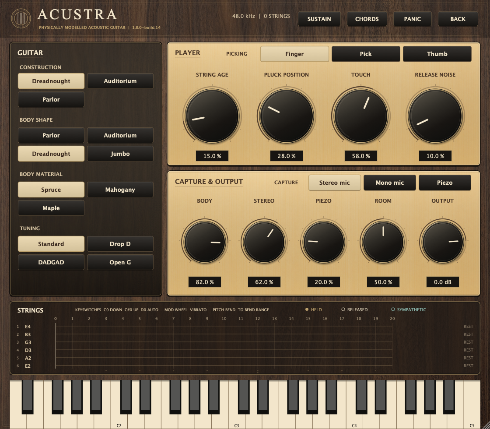

# Acustra

Acustra is an acoustic-guitar instrument for VST®3, CLAP, Audio Unit and
Standalone hosts. It synthesises every note in real time from six physical
string models, a passive measured bridge and a measurement-derived guitar
body. The plug-in contains no sample player and no recorded note audio. The
[user guide](Docs/guide/user-guide.md) covers installing and playing it.

[](Docs/screenshots/acustra.png)

## Audio demos

One demo per factory preset, each played from its own phrase in
[`Docs/audio/midi/`](Docs/audio/midi) through the same `Performer` the plug-in
plays, at 48 kHz with no processing after the engine. Every main build renders
them with [`Tools/RenderPresetDemos.cpp`](Tools/RenderPresetDemos.cpp) and
rewrites this table. Longer technique and repertoire renders are described in
[Technique and repertoire renders](#technique-and-repertoire-renders).

<!-- audio-demos-begin -->

| # | Preset | Demo | Length | Peak |
| --- | --- | --- | --- | --- |
| 1 | Dreadnought Steel | [01-dreadnought-steel.wav](Docs/audio/01-dreadnought-steel.wav) | 11.7 s | -1.9 dBFS |
| 2 | Parlor Steel Fingerstyle | [02-parlor-steel-fingerstyle.wav](Docs/audio/02-parlor-steel-fingerstyle.wav) | 11.6 s | -8.1 dBFS |
| 3 | Mahogany Steel Thumb | [03-mahogany-steel-thumb.wav](Docs/audio/03-mahogany-steel-thumb.wav) | 11.8 s | -9.7 dBFS |
| 4 | Jumbo Steel Pick | [04-jumbo-steel-pick.wav](Docs/audio/04-jumbo-steel-pick.wav) | 11.1 s | -4.3 dBFS |
| 5 | Palm Muted Steel Pick | [05-palm-muted-steel-pick.wav](Docs/audio/05-palm-muted-steel-pick.wav) | 11.2 s | -4.0 dBFS |
| 6 | DADGAD Mono Mic | [06-dadgad-mono-mic.wav](Docs/audio/06-dadgad-mono-mic.wav) | 11.2 s | -12.1 dBFS |
| 7 | Open G Slide-ready | [07-open-g-slide-ready.wav](Docs/audio/07-open-g-slide-ready.wav) | 11.5 s | -7.2 dBFS |
| 8 | Piezo Stage Steel | [08-piezo-stage-steel.wav](Docs/audio/08-piezo-stage-steel.wav) | 10.6 s | -8.1 dBFS |

<!-- audio-demos-end -->

## Version history

Each entry is a source version in this repository; none has been published
as a release yet. Earlier dated entries (2026-08-31 to 2026-10-10) and the
long per-version notes are in the
[release history](Docs/release/release-history.md).

### 1.9.0 — 2026-10-23 — less CPU during retuning, identical output

- Reduce SDK complex-math overhead during continuous pitch bends, keeping
  the library's arithmetic and exact output. Exceptional values and directed
  rounding retain the original library path. The native plug-in keeps its
  standard-library implementation.
- Continue the current 1.6.3 sound, including its velocity response, strums,
  body contact and release behavior. The owner requested this version for
  the fresh Rack Extension 1.9.0d2 rebuild; the earlier, pre-renumbering
  1.9.0 source and packages remain archived separately.
- [Exact-output checks and SDK timing](Docs/validation/exact-bend-cpu-2026-10-23.md).

### 1.6.3 — 2026-10-22 — softer velocity contrast, steadier strums, 10% Room

- Playing force follows MIDI velocity in proportion instead of its square,
  so soft and medium notes sit closer to firm ones: on factory preset 1, D3
  at velocity 24 now sounds 12 dB under velocity 120 instead of 27 dB.
  Full velocity is unchanged, and soft notes keep their slower, darker
  release. Hammer-ons and pull-offs follow the same force law.
- Repeated strums at one velocity draw a one-dB force residual instead of
  the recorded players' ±7.74 dB accents, so a fixed-velocity strum pattern
  no longer swells at random. Stroke direction, edge strings and ringing
  still vary the level.
- The plug-in starts new instances at 10% Room, as the Rack device does;
  saved sessions keep their Room.
- These are the owner's 2026-10-13 requests, authored keyboard responses
  rather than measurements ([notes](Docs/research/responsive-dynamics-2026-10-22.md)).

### 1.6.2 — 2026-10-22 — the player's body damps the guitar

- Fixed torso/back and forearm/top contact add passive loss to the body
  while playing and through note releases. Body resonances decay sooner
  (body modes at 209, 410 and 765 Hz ring 7%, 10% and 15% shorter);
  strings feel the same damped body through the bridge. The two loss
  strengths are authored approximations, not measurements, and were chosen
  by ear (Docs/decisions.md, 2026-10-22). No new control or saved
  parameter; existing sessions intentionally use the new body response. The
  [design and validation](Docs/research/player-contact-2026-10-20.md)
  distinguishes authored losses from measured guitar data.

### 1.6.1 — 2026-10-22 — eight factory presets, four tunings, no two notes at quite the same pitch

This version collects the source versions numbered 1.7.0, 1.8.0 and 1.9.0
until 2026-10-22, none of them released; the owner folded them into the
lowest number above the Rack Extension's 1.6.0f4, which Reason requires
later builds to exceed.

- **Eight factory presets.** The plug-in's program list holds eight factory
  presets, the Rack Extension's factory patches value for value
  ([user guide](Docs/guide/user-guide.md#factory-presets)). Each has a demo
  phrase written for it in `Docs/audio/midi/`.
- **Four tunings.** The Half-step down tuning is gone from the Tuning
  control, the engine and the Rack Extension, which now offer Standard,
  Drop D, DADGAD and Open G. Saved values are not migrated: a stored
  Half-step down plays Open G, and Tuning automation written for five
  choices lands on different tunings.
- **No two notes at quite the same pitch.** Each contact, a pluck, a
  re-pluck or a hammer-on, sounds a small pitch offset of its own, as a
  fretting finger presses the string a little differently every time:
  within +/-3 cents on a fretted note and +/-1 on an open string or
  harmonic. Both lie inside the note-to-note scatter measured on GuitarSet
  (`Tools/MeasureFrettedPitchScatter.py`) and were chosen by ear between
  its bounds. No control changes; Detune still adds its own wider spread on
  top.

### 1.6.0 — 2026-10-17 — playing and room realism, smoother pick, CLAP

- Seven playing and room changes, with a blind A/B pack but no claimed
  listener preference: independent
  hammer-on work, a lateral pull-off pluck, bounded two-finger timing, a
  winding-ridge texture on slides, held chord shapes keep skipped strings
  damped, receiver-specific early room reflections, and a corrected room
  rate conversion ([report](Docs/research/realism-quick-wins-2026-10-16.md)).
- Pick contact roughness at half amplitude and the room's stereo side
  high-passed at 150 Hz, accepted on 2026-10-15
  ([sound refinements](Docs/research/sound-refinements-2026-10-15.md),
  [room bass](Docs/research/room-smoothness-2026-10-15.md)).
- Exact-output CPU work: the rendered audio is unchanged
  ([CPU optimization](Docs/benchmarks/cpu-optimization-2026-10-16.md)).
- A CLAP plug-in on macOS, Windows and Linux.
- The version number now matches the Rack Extension, which shipped this
  engine as 1.6.0f1–f4; parameter IDs and saved sessions are unchanged.

### 1.5.0 — 2026-10-14 — the playing hand, measured

[Details](Docs/release/release-history.md#150--2026-10-14--the-playing-hand-measured).

### 1.4.0 — 2026-10-13 — upstrokes lean treble, picked notes alternate, released notes fall

[Details](Docs/release/release-history.md#140--2026-10-13--upstrokes-lean-treble-picked-notes-alternate-released-notes-fall).

### 1.3.4 — 2026-10-13 — chord joins keep their common tones, and a piezo polarity switch

- A chord refingered inside the release-join window no longer loses the
  stroke on a string the two chords share, and every damping contact takes
  its own string travel geometry while earlier arrivals keep theirs.
- **Invert Piezo Blend** on the back reverses only the pickup mixed under
  microphone Capture; Piezo-only Capture and the separate Piezo output keep
  their polarity. Normal is the default, including for older sessions, and
  switching glides.

### 1.3.3 — 2026-10-12 — launch preparation: packages, notices, Standalone MIDI, editor size

[Details](Docs/release/release-history.md#133--2026-10-12--launch-preparation-packages-notices-standalone-midi-editor-size).

### 1.3.2 — 2026-10-12 — the mid-band peak takes a dip, and a bit of piezo

[Details](Docs/release/release-history.md#132--2026-10-12--the-mid-band-peak-takes-a-dip-and-a-bit-of-piezo).

### 1.3.1 — 2026-10-12 — the Parlor's air-mode dip, and the second MIDI audit

[Details](Docs/release/release-history.md#131--2026-10-12--the-parlors-air-mode-dip-and-the-second-midi-audit).

### 1.3.0 — 2026-10-12 — strum direction timed by the song, and keyswitches

[Details](Docs/release/release-history.md#130--2026-10-12--strum-direction-timed-by-the-song-and-keyswitches).

### 1.2.0 — 2026-10-11 — a Sustain switch, and the sweep smoothed by measurement

[Details](Docs/release/release-history.md#120--2026-10-11--a-sustain-switch-and-the-sweep-smoothed-by-measurement).

## Downloads

<!-- The block between the build-download markers is rewritten by .github/workflows/main-build.yml; edits there are overwritten. -->
<!-- build-download-begin -->
**[Download main build 28](https://github.com/protocodus/virtual-instrument-acustra/actions/runs/40471943571/artifacts/12721230457)**, built from [`710c2e904875`](https://github.com/protocodus/virtual-instrument-acustra/commit/710c2e904875f9a9442fcd590d35f6c7f274dd3f). It holds the macOS, Windows and Linux packages, `SHA256SUMS` and `BUILD.txt`.
<!-- build-download-end -->

---

## How it works

Acustra is two layers, and only the outer one knows a host. The instrument is
JUCE-free C++17 under `Source/DSP/`: `AcustraEngine` is the physical model,
and `AcustraPerformer` is the player in front of it. The player splits each
block at its events and turns MIDI into engine calls - channels, the MPE lower
zone and its controller scope, RPN bend ranges, CC1/2/64/74 (CC68 is ignored; see below), channel
pressure and the string-per-channel mode, same-sample chord grouping and
strums, and the Gather Chords window with the latency it costs. The plug-in's
processor is a thin JUCE adapter around it (parameters, saved state, editor,
bus layout) that decides nothing about how a note is played. A front end
without MIDI, such as the Reason Rack Extension, spells its notes and
controllers as the same MIDI messages at their sample offsets, so every front
end plays one behaviour rather than a port of it.

Each block below is summarised: what is modelled, how, and from which
references. [How it works, in detail](Docs/research/how-it-works-1.7.0.md)
gives every mechanism, measurement and citation in full, and
[`Docs/decisions.md`](Docs/decisions.md) records the choices made by ear.

### Six-string performance model

**What.** A guitarist's two hands on six steel strings, played from MIDI.

**How.** Each note takes one string and fret. A fretting-hand cost chooses
them: a hand in position covers four frets and stretches to a fifth, held and
recently released notes place it, and among equal costs an open string, a
lower fret and a silent string win; a repeated note re-plucks the string still
sounding it. Four tunings (Standard, Drop D, DADGAD, Open G)
change the strings' tension at fixed gauge, and only the tuning's range
sounds (E2 to C6 in Standard). Notes on one sample and channel are fretted as
one chord shape and, with a pick, swept as a strum whose string timing,
scatter, lighter entry and exit strings and upstroke balance are measured on
GuitarSet; under Finger three or four strings are plucked together. Strums
alternate within a dotted eighth; keyswitches C0, C#0 and D0 latch down, up or
automatic. Gather Chords (CHORDS) groups keys within 30 ms into one shape at
30 ms of reported latency. A key-up waits one 1/32 note, so a re-struck note
joins its ringing string, then the hand damps it, adds its own touch (Release
Noise) and lets a fretted note's pitch fall as GuitarSet's note ends do.
CC64 and the SUSTAIN switch hold released notes. CC2 is the picking hand's
heel by the saddle. CC1 is vibrato through string tension; channel pitch bend
is a slide along the neck, and an MPE member's bend pushes the string across
the fret through its tension. MPE (lower zone), CC74 pluck point,
string-per-channel mode (CC126/127) and connected finger gestures
(CC65 + CC84) are supported. A retaken string keeps its old wave as a damped
tail; a re-plucked one continues its own vibration.

**References.** Hand spans from [Heijink and Meulenbroek, J. Motor Behavior 34(4), 2002](https://www.socsci.ru.nl/meulenbroek/Publications/Heijink%20en%20Meulenbroek%202002.pdf);
strum and release statistics from GuitarSet (`Tools/MeasureStrum*.py`,
`Tools/MeasureStroke*.py`); the chord window from
[Goebl, JASA 110(1), 2001](https://iwk.mdw.ac.at/goebl/papers/Goebl_JASA2001_melodyLead.pdf);
bends by Grimes, PLoS ONE 9(7):e102088, 2014; vibrato rates by Erkut et al.,
AES preprint 5114, 2000; transition timing by
[Laurson et al., CMJ 25(3), 2001](https://aaltodoc.aalto.fi/bitstreams/768dbe9c-526c-414a-b2ce-0742574b8064/download);
the [release-window contract](Docs/research/release-join-2026-10-05.md).

### Pluck and strings

**What.** Six stiff steel strings, each vibrating in two polarisations, and
the hand or plectrum that lets them go.

**How.** Each polarisation is a full-round-trip stiff-string waveguide whose
fractional delay is a Thiran allpass and whose dispersion follows the
stiff-string inharmonicity law through two allpass sections. Both planes carry
the same intrinsic loss, with winding friction and bending loss on the wound
strings; String Age lowers the cutoff and raises those losses. A pluck writes
a triangular release rounded by a Gaussian contact, at a displacement set by
the force the hand holds; Pluck Position, Touch and velocity move its point,
width, level and brightness. The Pick adds a fitted release velocity, and every
technique lets the string slide off a rounded edge, so softer strokes are
released darker. A short noise burst carries release detail. Most of a steel
pluck goes into the plane parallel to the top, which reaches the body through
the saddle's measured rocking and gives partials their beating doublets. A
bounded Kirchhoff-Carrier surrogate sharpens the attack pitch.

**References.** Laakso, Valimaki, Karjalainen and Laine, IEEE Signal
Processing Magazine 13(1), 1996; Woodhouse, Acta Acustica 90, 2004 (the
polarisation end correction, shipped at zero by ear); crown heights from
R. Mores, *List of guitars measured*, 2021; the
[contact kernel](Docs/research/contact-kernel-and-power-2026-09-08.md) and
[string loss](Docs/research/string-hf-loss-2026-10-10.md) reports.

### Bridge, sympathetic strings and body

**What.** A passive measured bridge, the six strings coupled through it, and
the measured body that radiates.

**How.** Each string ends on the bridge at its own point along the saddle; a
spatial modal bridge (47 modes, 30 rocking) with positive-semidefinite residue
matrices keeps the junction passive, and a plate conductance floor restores
the loss a real top keeps between its high modes. All six strings, played or
idle, are members of one two-way junction, which bounds sympathetic ringing.
The body's normal force and moment drive 132 measured radiation poles, shared
with the bridge where both measurements see the same resonance, continued
statistically above the fitted 10 kHz band. Steel plays a lighter blend
measured to stand in for the listener's preferred mix
([`SteelBodyBlend.h`](Source/DSP/SteelBodyBlend.h)). The microphone
observation is a fixed weighted mix of measured and spatial pressure paths;
Mono mic uses its right observation.

Fixed torso/back and forearm/top contact add two passive structural losses
to the body modes. These are conservative authored frequency envelopes,
not measurements of a player's posture. They shorten free body ringing
while the bridge and tuning observer follow the same loaded body; string
release, palm muting and room decay remain separate mechanisms. See the
[contact model](Docs/research/player-contact-2026-10-20.md).

**References.** Robert Mores' bridge and radiation archive (g21, CC BY 4.0);
the steel-string mobility level from [Carcagno et al.](https://doi.org/10.1121/1.5084735)'s
Fylde Falstaff measurement; the
[measurement-informed guitar model, DAFx-26](https://dafx26.mit.edu/assets/papers/DAFx26_paper_40.pdf);
the [saddle-termination report](Docs/research/saddle-termination-2026-10-10.md);
the [DSP completion register](Docs/research/dsp-finalization-2026-10-11.md).

### Construction controls

**What.** Bounded directions around the one measured guitar, not separate
measured instruments.

**How.** Shape re-couples the measured air (A0) and top (T1) modes for a
published box's volume, soundhole and top area and scales the plate modes with
the top, in the bridge and the radiation alike. Body Material substitutes
spruce, mahogany or maple plate properties at fixed geometry. The Guitar
switches set Shape and Material together. Every construction and Picking plays
at the default's loudness, within 1 LU, from a measured gain table
([`ConstructionLoudnessData.h`](Source/DSP/ConstructionLoudnessData.h)). The
under-saddle piezo is a component-level chain: string forces on the element, a
bone saddle on its stiffness, the element's charge source and cable, and a
documented 9 V preamp solved stage by stage.

**References.** Christensen and Vistisen, J. Acoust. Soc. Am. 68(3), 1980;
Martin, Taylor, Gibson and Fender published dimensions; Fletcher and Rossing,
*The Physics of Musical Instruments*, ch. 9; the
[wood model](Docs/research/wood-materials-2026-10-11.md); for the piezo,
Zollner, *Physics of the Electric Guitar*, ch. 6, ESP
[Project 202](https://sound-au.com/project202.htm) and TI SBOS058B.

| Control | Audible behavior |
| --- | --- |
| **Shape** | Parlor, Auditorium, Dreadnought or Jumbo: the measured body's A0 and T1 re-coupled for that box, with the plate modes scaled with the top; all three captures hear it. |
| **Body Material** | Spruce, Mahogany or Maple plate material at fixed geometry; a session saved with Cedar loads as Mahogany. |
| **Tuning** | Standard, Drop D, DADGAD or Open G; a retuned string keeps its gauge, so its tension follows its pitch. |
| **Picking** | Finger, Pick (sharper, nearer the bridge, darker when soft) or Thumb (rounder, nearer the neck). |
| **Capture** | Stereo mic, a single measured mono mic, or the under-saddle piezo through its preamp. |
| **Piezo Mix** | The piezo beneath the microphones on Main; 20% for a new instance, 0% for an older session. |
| **Release Noise** | The damping hand's touch as a note ends, and faint friction on held wound-string slides; 0% adds nothing. |
| **Room** | Small-studio reflections around the microphones, 0-100% (10% for a new instance); the piezo stays dry. |
| **Sustain** | Every released note rings as under the pedal, on every channel, until its string is taken or the switch goes off. |
| **String Age** | Lower string cutoff and more loss; an old set's basses lose their upper partials first. |
| **Pluck Position** | The hand from bridgeward toward the neck, bending smoothly toward 0.36 of a short string. |
| **Touch** | Contact width, transient colour and brightness, and how fast every technique lets the string go. |
| **Body Amount** | Scales microphone radiation. |
| **Stereo Width** | The stereo pair toward mono. |
| **Output** | Final gain; linear through −1 dBFS, then a headroom-only safety limiter. |

### The top's spring-back

**What.** Before a pluck the hand holds the string aside and the top stands
deflected under the saddle force; at release the top springs back and rings
the air and lowest top modes on every note.

**How.** The engine reads that released force from the wave it wrote and
returns it to the junction as a high-passed step at the string's saddle point,
at 0.45 of the full force (the level a listener chose); the piezo observes the
same released load.

**References.** Comparison with the Eastman E1D and Martin HD28 recordings;
the [released-load correction](Docs/research/piezo-release-load-2026-10-11.md).

### The microphones and the room

**What.** How the close microphones colour the body, and the room around them.

**How.** A fitted capture voicing (a low shelf and five broad peaks, applied to
the summed microphone pressure) and a small brightness tilt correct the
measured close observation toward five sets of real flat-top recordings. Room
puts a 5.2 x 4.1 x 2.7 m studio around the microphones: ten image-source early
reflections, then an eight-line feedback delay network; it never reaches the
piezo.

**References.** [`CaptureVoicingData.h`](Source/DSP/CaptureVoicingData.h) and
[`Tools/FitCaptureVoicing.py`](Tools/FitCaptureVoicing.py); the
[body and capture audit](Docs/research/body-capture-2026-10-08.md), the
[studio capture implementation](Docs/research/studio-capture-implementation-2026-10-11.md)
and the [room report](Docs/research/room-2026-10-10.md).

### Outputs

| Output | Channels | What it carries |
| --- | --- | --- |
| **Main** (`Output`) | stereo, always on | Whatever Capture selects, with the piezo beneath it at Piezo Mix. |
| **Piezo** | mono, optional | The under-saddle piezo and its preamp, whatever Capture selects. |

Both outputs are seven samples behind the strings at every rate, so the two
sensors sum as the instrument moved them; the plug-in reports that latency,
plus 30 ms while Gather Chords is on. In VST3 the Piezo bus is optional and
off by default. The plug-in plays at host rates from 8 kHz to 384 kHz and stays
silent, showing UNSUPPORTED RATE, at any other. An idle instance stops
computing the strings and wakes with output bit for bit that of one that never
slept.

### Why this architecture

Acustra keeps a realtime waveguide string on a measured bridge and body, after
the [measurement-informed nonlinear guitar model](https://dafx26.mit.edu/assets/papers/DAFx26_paper_40.pdf)
(DAFx-26), with a two-way six-string junction in place of its one-way idle
strings. Offline fitting follows the
[differentiable Karplus-Strong study](https://dafx26.mit.edu/assets/papers/DAFx26_paper_38.pdf)
on bounded physical parameters. A measured 2-D bridge
([Bank and Karjalainen, DAFx-10](https://www.dafx.de/paper-archive/2010/DAFx10/BankKarjalainen_DAFx10_P60.pdf))
and a geometrically exact string with fret contact
([DAFx-24](https://www.dafx.de/paper-archive/2024/papers/DAFx24_paper_50.pdf))
inform the roadmap but are not implemented.
[`ModalPreloadProbe.cpp`](Tools/ModalPreloadProbe.cpp) is an offline
reference for a string held before release, after
[Woodhouse's constrained modal construction](https://euphonics.org/wp-content/uploads/2022/03/Guitar_I.pdf).

### Recordings are calibration references only

The separate `AcustraReferenceBank` holds 280 CC0 regions (272 Shinyguitar
steel regions and 8 Eastman E1D finger-plucked anchors). Only the offline
fit renderer and reference-bank tests link it; the plug-in contains no recorded
audio. The fitter renders the engine deterministically and scores it against
those references on seven robust terms (attack spectra, harmonic envelopes,
tuning and inharmonicity, early pitch trajectory, decay, body spectrum and
velocity dynamics), with training, development-validation, a reported-only
flat-top split and a frozen test split. The calibration stores 25 bounded
values, in the order of `NAMES` in
[`OptimizePhysicalModel.py`](Tools/OptimizePhysicalModel.py); listener choices
override the fit where recorded. Scores are paired measurements, not
constants. The [real dry-note benchmark](Docs/research/real-dry-note-benchmark.md)
compares the fit with real recordings, and [verification](Docs/validation/verification.md)
records the measured checks.

## Known gaps

What the current instrument does not model, or models only by an authored or
fitted stand-in, and the evidence that would close each. The dated
measurements behind these entries, and earlier gaps since closed, are in the
[known-gaps ledger](Docs/research/known-gaps-ledger-2026-10-17.md); the
[DSP completion register](Docs/research/dsp-finalization-2026-10-11.md)
separates verified errors from accepted approximations.

**Playing and MIDI**

- Strum direction follows an interval rule, not the host's beat grid. A
  listening pass of the interval rule decides whether a beat-grid rule is
  needed.
- The upstroke's level offset and tilt, the stroke edges and the release
  pitch fall are corpus means; players' accents, a finger's release speed and
  upstrokes' thinner bass reach are not separated or modelled. A per-stroke
  annotated corpus would separate them.
- A single picked upstroke radiates 2.1-3.8 dB more than a downstroke on the
  treble strings; no measurement here says whether a real plectrum does.
- Live chords with Gather Chords off can keep a wider fingering than one hand
  reaches. The hand's span and costs follow the listener's direction and a
  finger-span study, not recorded fingerings.
- MIDI limits: the MPE zone is not saved with a session; RPN Data
  Increment/Decrement are ignored; the Sustain switch acts at block start;
  Panic leaves CC2 where it is; upper-zone MPE and per-note aftertouch beyond
  the CC74/pressure bias are absent.
- Tapping, slapping, fret buzz, artificial and pinch harmonics, body knocks
  and a moving-fret boundary for hammer-ons are absent; slide roughness and the
  hammer-on contact are authored. Fret collision fires when built but needs a
  measured string displacement before it can ship. A close-miked solo
  slide/bend capture would calibrate the slide texture.

**Strings and excitation**

- The strings are linear apart from the bounded attack-pitch surrogate; the
  geometrically exact nonlinear string, which supplies up to about 58% of the
  recordings' loud-layer brightness rise, is not built. Velocity brightens a
  Pick stroke about half as much as the recordings show.
- The recordings snap and then mellow; the engine's upper partials die at
  about 35% of the recorded rate and the attack transient those partials stood
  for is missing. The Finger's attack stays brighter than the finger-plucked
  recordings'. A noise-free or floor-documented finger-plucked steel corpus,
  and an attack transient a listener accepts, would settle both.
- Attack colour varies less between repeated takes than real round robins
  (34-81 against about 270-290 cents of centroid spread); the plucking angle's
  real spread is not measured.
- Pick and Thumb dimensions are authored and the plectrum's values are fitted
  to one picked archtop; no beam/friction plectrum solver is available.
- The pluck is a propagated ideal shape, not a finger-loaded rest state;
  dispersion above H12 is not fitted (about 30 cents by H24 on the open low E);
  the highest partials' decay still varies by up to about 5% between 44.1, 48
  and 96 kHz.
- Where the pluck nearly nulls a partial, the random release burst decides its
  level.

**Bridge and body**

- Shape and Body Material morph one measured, nylon-strung flamenca (g21);
  the steel-string mobility level comes from one other guitar. A measured body
  of each size, and a bridge mobility measured strung on a steel-string
  guitar, would replace the morphs.
- The parallel polarisation reaches the body through the measured rocking,
  not a measured tangential admittance; the saddle's in-plane translation is
  unmeasured. Sharing the normal loop's bridge compensation leaves sustained
  pitch up to 9 cents off on a few Dreadnought notes, kept by ear for its
  beating.
- Notes near strong lossy body modes sit a few cents from their request, and
  coincident partials in chords pull up to about 10 cents; each Shape has an
  air-mode note that drains fast, and the Parlor's B2 and A#2 stand 3-5 dB over
  their neighbours.
- Low-frequency damping is too fast below 180 Hz and too slow above; the
  by-ear plate conductance floor is about seven times the value measured from
  the same record. A bridge mobility measurement of the modelled instrument
  would close both.
- Note-to-note level is rougher than the open recordings' (2.2 dB against
  1.8); the holes are the measured bodies' antiresonances at a close
  microphone. The default 20% Piezo Mix deepens two of them (Parlor F#5,
  Jumbo C5) and has not been heard yet. A bridge-microphone fit to the
  archive's measured positions, heard before it ships, would be the way to
  close them.
- Radiation above each bank's fitted band (8-12 kHz up) is a statistical
  continuation; a microphone response measured past 10 kHz would replace it.
- The two-way junction has not been refitted since the strings came to end on
  the bridge; the converged refit failed engine regressions and is held for
  the ear.

**Capture, room and level**

- The capture voicing is a consensus correction from other guitars'
  recordings, and the room is a model; a steel-string guitar's own response
  measured where a recording is made, and a measured room, would replace them.
- The piezo's saddle bending modes, slot friction and real string balance are
  not modelled, and there is no matched piezo recording.
- The hardest playing (velocity 127, Pick, Touch 1, Pluck Position 0) reaches
  the safety limiter on most constructions; keeping it under the knee would
  lower every construction by 2.6 dB, which is the user's choice. Loudness is
  matched over a phrase set, so one strum can sit up to about 6.6 dB from the
  default construction's.

**Evidence**

- The steel calibration corpus is a miked archtop, and none of it was recorded
  on the guitar that supplied the bridge and body; same-instrument controlled
  plucks with reciprocal saddle admittance and microphone paths are needed.
  The corpus also prefers a bridge mobility a quarter of the measured one,
  which is not taken.
- The single-note benchmark cannot see polyphonic faults; chord and release
  corrections are gated by derivation and direct regressions only.
- One listening question from 2026-09-01 (the close-microphone pair) is
  outstanding, and no controlled expert study has compared this build with
  real guitars or commercial instruments.

## Build

The DSP core - the engine and the player (`Source/DSP/AcustraEngine.*` and
`Source/DSP/AcustraPerformer.*`, the `AcustraDSP` library, which also builds
as C++17 for the Rack Extension) - physical-engine tests, offline
reference-bank tests and renderers require CMake 3.22 and a C++20 compiler;
they do not require JUCE:

```sh
cmake -S . -B build-dsp -DACUSTRA_BUILD_PLUGIN=OFF -DBUILD_TESTING=ON -DCMAKE_BUILD_TYPE=Release
cmake --build build-dsp --parallel
ctest --test-dir build-dsp -L "unit|audio" --output-on-failure
./build-dsp/AcustraRenderDemos Docs/audio
```

The Python self-tests are registered only when CMake's Python 3 can import
NumPy and SciPy; pass `-DPython3_EXECUTABLE=<a Python with numpy and scipy>`,
and `-DACUSTRA_REQUIRE_PYTHON_TESTS=ON` (as CI does) to make their absence a
configure error. Render the demos from a Release build: one platform
reproduces its own WAVs byte for byte, but renders differ across platforms.
The [expressive repertoire](#expressive-repertoire) is generated with
`Tools/PerformRepertoire.py` and `./build-dsp/AcustraRenderRepertoire`.

The plug-in build fetches pinned JUCE 8.0.14 unless `ACUSTRA_JUCE_PATH` names a
local checkout, and clap-juce-extensions `c1a5ad02` for the CLAP unless
`ACUSTRA_CLAP_JUCE_EXTENSIONS_PATH` does (`-DACUSTRA_BUILD_CLAP=OFF` skips it):

```sh
cmake -S . -B build-plugin -DCMAKE_BUILD_TYPE=Release -DACUSTRA_BUILD_PLUGIN=ON -DBUILD_TESTING=ON
cmake --build build-plugin --config Release --parallel
ctest --test-dir build-plugin -C Release --output-on-failure
```

macOS builds VST3, Audio Unit, CLAP and Standalone (universal arm64/x86_64 by
default); Windows and Linux build VST3, CLAP and Standalone, with the C++
runtime linked statically. On macOS the scripts build, test, sign and package:

```sh
./scripts/build-macos.sh
./scripts/sign-and-package-macos.sh
```

`sign-and-package-macos.sh` signs ad hoc unless `APP_SIGN_IDENTITY`,
`INSTALLER_SIGN_IDENTITY` and `NOTARY_PROFILE` name Developer ID identities and
a notarytool profile. Rack builds also need the current Rack panel source
(selector layout at Rack revision `d6b6dbf`); the JUCE editor is not part of
a Rack build.

For dry-note comparisons, `AcustraPhysicalFitRenderer` takes the output
directory and the 25 calibration arguments in `OptimizePhysicalModel.NAMES`
order. The offline fit, recording benchmarks, audits, reference host and
table generators are described in
[offline measurement tools](Docs/research/offline-measurement-tools.md).

### Technique and repertoire renders

Alongside the preset demos, two local renderers exercise the engine's
techniques and a longer repertoire. Their WAVs are not committed: generate
the ten technique demos with `./build-dsp/AcustraRenderDemos Docs/audio`; the
output goes into `Docs/audio/` and is ignored by Git.

These PCM16 stereo WAVs are rendered deterministically by
[`Tools/RenderDemos.cpp`](Tools/RenderDemos.cpp) through the same JUCE-free
`AcustraEngine` used by the plug-in. Each file receives one whole-file peak
normalisation after rendering. There is no external post-EQ, compression,
reverb, room effect or recorded-note layer, and the engine's own Room is at
its engine default, off (the plug-in starts at 10%).

- **Steel sustain range** — isolated held
  notes from open E2 through B5.
- **Shape and material anchors** — the
  same chord at the Parlor/Jumbo and Mahogany/Maple endpoints.
- **String age** — the same steel phrase with fresh
  and fully aged settings.
- **Alternate tunings** — Drop D, DADGAD and
  Open G partial chords.
- **Playing behaviours** — a chord change
  over a still-ringing chord, CC2 bridge-hand damping, then two natural
  harmonics above the fretted range (rendered before 2026-10-12; those two
  pitches are silent since the instrument answers only its tuning's range).
- **Strummed chords** — chords sent on one
  sample swept as alternating strums, then one chord eight times hand-damped,
  no two strokes the same take.
- **Recuerdos de la Alhambra** —
  Tárrega's tremolo study, bars 1–12 on an Auditorium in Mahogany: the
  thumb keeps an arpeggio
  while three fingers repeat one melody note on one string, ten strokes a
  second, each landing on a string the last stroke left ringing. The fretted
  melody stays held through the thumb slots; its written short note lengths
  do not ask the damping hand to interrupt each group.
- **Lágrima** — Tárrega, bars 1–8 on the same
  guitar played slowly, where the sustain and the beating between coupled
  strings carry the piece rather than the attack.
- **Picking techniques** — identical notes
  and velocity with Finger, Pick and Thumb on steel strings.
- **Capture types** — the same steel performance
  through stereo mic, mono mic, then piezo. Native relative levels are
  retained: the piezo is level-matched to the microphones by loudness, and its
  sensitivity is anchored to a published level, not a measurement of hardware
  gain.

<!-- peaks-table-begin: regenerated by AcustraRenderDemos; edits between the markers are overwritten -->
| File | What it is | Length | Rendered peak | Normalisation |
| --- | --- | ---: | ---: | ---: |
| `01-steel-sustain-range.wav` | Steel sustain from open E2 to B5, one held pluck at a time | 9.5 s | −12.7 dBFS | +9.7 dB |
| `03-shape-material-anchors.wav` | One chord: Parlor/Jumbo, then Mahogany/Maple anchor settings | 13.7 s | −8.3 dBFS | +5.3 dB |
| `04-string-age.wav` | The same steel phrase with fresh strings, then fully aged strings | 6.5 s | −12.1 dBFS | +9.1 dB |
| `05-alternate-tunings.wav` | Drop D, DADGAD and Open G chords | 12.3 s | −11.1 dBFS | +8.1 dB |
| `06-playing-behaviours.wav` | A chord change over a ringing chord, CC2 bridge-hand damping, then two natural harmonics above the fretted range | 10.7 s | −11.6 dBFS | +8.6 dB |
| `08-strummed-chords.wav` | Same-sample chords swept as alternating strums, then one chord eight times hand-damped, no two strokes the same take | 6.9 s | −4.7 dBFS | +1.7 dB |
| `09-recuerdos-de-la-alhambra.wav` | Tarrega, Recuerdos de la Alhambra, bars 1-12: a tremolo over a thumb arpeggio on an Auditorium in Mahogany | 31.6 s | −12.8 dBFS | +9.8 dB |
| `10-lagrima.wav` | Tarrega, Lagrima, bars 1-8: a sung melody over held bass on an Auditorium in Mahogany | 26.0 s | −11.7 dBFS | +8.7 dB |
| `11-picking-techniques.wav` | Finger, pick and thumb on the same notes and velocity | 5.3 s | −18.4 dBFS | +15.4 dB |
| `12-capture-types.wav` | Stereo mic, mono mic, piezo | 7.3 s | −19.1 dBFS | +16.1 dB |
<!-- peaks-table-end -->

#### Expressive repertoire

Fifteen longer pieces, solo and for ensembles of differently built guitars,
played as a performer would shape them rather than as the score is quantised.
They are 96 kHz, 24-bit stereo WAVs (32-bit float with `--float`), generated
locally like the demos above and ignored by Git:

```sh
python3 Tools/PerformRepertoire.py --midi-dir build-dsp/repertoire-midi \
    --download --out build-dsp/repertoire
./build-dsp/AcustraRenderRepertoire --out Docs/audio/repertoire \
    build-dsp/repertoire/*.txt
```

[`Tools/PerformRepertoire.py`](Tools/PerformRepertoire.py) reads the notes
from Mutopia Project MIDI files (pinned by md5, fetched by `--download`) and
writes each performance as a text file of timed events;
[`Tools/RenderRepertoire.cpp`](Tools/RenderRepertoire.cpp) plays every guitar
through its own `AcustraEngine`, sets it in the stereo field, sums them and
applies one whole-file peak normalisation to −1 dBFS. There is no reverb,
room, EQ or compression. What is authored, and nowhere enters the model:

- **The form** a player takes: repeats, which ending, the Da capo, echo
  dynamics and a different tone colour on a repeat.
- **Tempo.** Every phrase presses forward into its middle and relaxes out
  of it (Todd's phrase arch), slows into its cadence (more at a period end,
  more again at a section end), and a section can move on or hold back
  (accelerando, più/meno mosso); the last bars take Friberg and Sundberg's
  final ritardando and the last chord is left to ring. Tempo stays within
  0.45–1.55 times the base.
- **Dynamics** over about 80% of the engine's velocity scale (pp 0.20 to
  ff 0.80, the extremes 0.12 and 0.96), with a phrase arch coupled to the
  tempo arch, the melody above the accompaniment, metrical weight, a rising
  line growing, and per-note scatter.
- **The hands.** A correlated timing drift of about 10 ms per player and a
  few ms of jitter; chords rolled from the bass (more when soft or at a
  cadence, almost together in fast passages), a thumb just ahead of a
  pinched melody note; a tremolo whose three fingers differ in weight and
  spacing; a mazurka's or a sarabande's lean on its second beat; left-hand
  vibrato on long sung notes; arpeggios and held shapes left ringing until
  the harmony moves. In an ensemble every guitarist drifts independently, so
  the parts meet as players do: 8–20 ms apart at the median.
- **Balance.** The constructions, with their parts' registers, differ by up
  to about 10 dB in loudness, so each ensemble part is set to a level while
  it plays (melody on top, inner voices about 3 dB under, the bass 1–1.5 dB
  under; canon voices equal).

| File | What it is | Guitars |
| --- | --- | --- |
| `01-tarrega-lagrima.wav` | Tárrega, *Lágrima*, A A B B A | Auditorium, mahogany |
| `02-tarrega-adelita.wav` | Tárrega, *Adelita* (mazurka), A A B B A | Auditorium, mahogany |
| `03-tarrega-recuerdos-de-la-alhambra.wav` | Tárrega, *Recuerdos de la Alhambra*, complete, second ending | Auditorium, mahogany |
| `04-tarrega-capricho-arabe.wav` | Tárrega, *Capricho árabe*, complete, Drop D | Auditorium, mahogany |
| `05-milan-pavana-ii.wav` | Luis Milán, *Pavana II* (1536), twice through | Parlor, mahogany |
| `06-galilei-saltarello.wav` | Vincenzo Galilei, *Saltarello*, Drop D | Parlor, maple |
| `07-sanz-preludio.wav` | Gaspar Sanz, *Preludio* (1674) | Parlor, spruce |
| `08-bach-prelude-bwv999.wav` | Bach, Prelude in D minor, BWV 999 | Auditorium, mahogany |
| `09-bach-sarabande-bwv997.wav` | Bach, Sarabande from BWV 997 | Auditorium, mahogany |
| `10-bach-gavotte-en-rondeau-bwv1006a.wav` | Bach, Gavotte en rondeau from BWV 1006a | Dreadnought, spruce |
| `11-dowland-come-again-guitar-quartet.wav` | Dowland, *Come again*, two verses | Dreadnought maple; Parlor maple; Auditorium mahogany; Jumbo spruce |
| `12-arbeau-belle-qui-tiens-ma-vie-guitar-quartet.wav` | Arbeau, *Belle qui tiens ma vie*, three times: two voices, then four | Auditorium maple; Auditorium mahogany; Parlor mahogany; Dreadnought spruce in Drop D |
| `13-pachelbel-canon-guitar-quartet.wav` | Pachelbel, Canon in D | Auditorium mahogany; Auditorium maple; Parlor spruce; Jumbo mahogany in Drop D |
| `14-bach-goldberg-aria-guitar-trio.wav` | Bach, Aria from the Goldberg Variations (arr. Steve Shorter and J. D. Erickson, CC BY-SA 4.0) | Auditorium mahogany; Auditorium spruce; Dreadnought mahogany in Drop D |
| `15-bach-air-bwv1068-guitar-duo.wav` | Bach, Air from BWV 1068, with repeats | Auditorium mahogany; Jumbo spruce |

The strings are steel throughout, the instrument's only strings. These are
authored interpretations, not a claim about how the pieces must go, and like
every demo here they still need listening against real players.

### Packages

Packages are named `Acustra-<version>-build.<number>-<Platform>-<arch>` and
land in `dist/<version>/build.<number>/<Platform>-<arch>/` with a manifest and
checksums; `ACUSTRA_BUILD_NUMBER` sets the build number. See
[packaging and the release workflow](Docs/release/packaging-and-release-workflow.md).

### Release workflow

[`.github/workflows/release.yml`](.github/workflows/release.yml) builds,
validates (whole test suite on macOS, auval and pluginval) and packages macOS
universal, Windows x64 and Linux x64 from one commit, and drafts a GitHub
release on a pushed `v*` tag.
[`.github/workflows/main-build.yml`](.github/workflows/main-build.yml) runs it
on every push to `main`, nightly and on demand, and rewrites the
[Downloads](#downloads) block. Signing secrets, release steps and the owner's
open decisions before publishing are in
[packaging and the release workflow](Docs/release/packaging-and-release-workflow.md#release-workflow).

## Licensing

Acustra's source is available under the [PolyForm Noncommercial License
1.0.0](LICENSE): you may read, study, change and share it for any non-commercial
purpose, but not sell it or use it commercially. Official Protocodus builds
carry an additional permission in the same file to use them for any purpose,
including making music commercially. Commits made before this licence change
were published under MIT and remain so. The Shinyguitar and Eastman E1D
recordings in the offline reference bank are dedicated under CC0 1.0 and are not
linked into the plug-in. The measured bridge/body coefficient tables are adapted
from Robert Mores' archive under CC BY 4.0, and two derived level constants and
the piezo's bridge conductance from Carcagno et al.'s Fylde measurement, also CC
BY 4.0. GuitarSet, CC BY 4.0, is one of the recording sets the capture voicing
is fitted to and the source of three strum statistics. JUCE is a separate
dependency offered under AGPLv3 or a commercial JUCE licence (official builds
use a JUCE 8 Starter licence), and the libraries it compiles in (the VST3 SDK,
HarfBuzz, SheenBidi, libpng, zlib, the IJG JPEG code and, on macOS, Apple's
AudioUnitSDK) carry their own licences, collected in
[`ThirdParty/JUCE-DEPENDENCY-LICENSES.txt`](ThirdParty/JUCE-DEPENDENCY-LICENSES.txt).
See [`THIRD_PARTY_NOTICES.md`](THIRD_PARTY_NOTICES.md) and the files in
[`ThirdParty`](ThirdParty) before distributing a combined plug-in or app; the
desktop packages ship them with the [user guide](Docs/guide/user-guide.md).

VST is a registered trademark of Steinberg Media Technologies GmbH.
